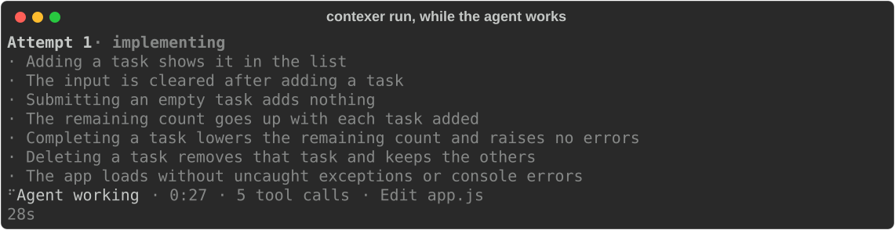
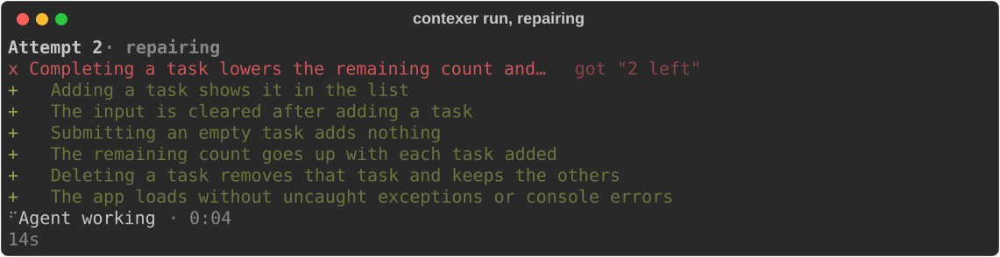
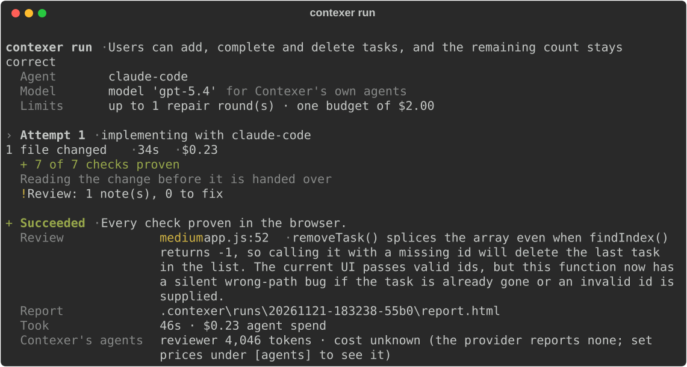
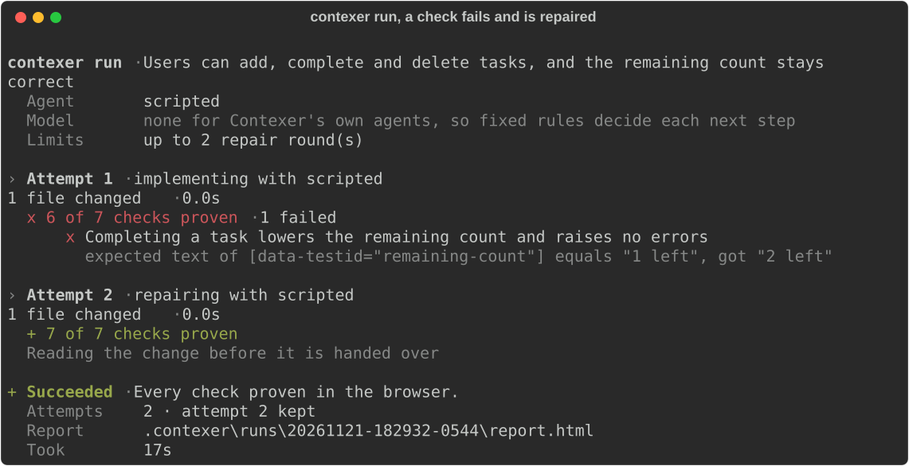

# Contexer

[](https://github.com/murtuza777/contexer-agent/actions/workflows/ci.yml)
[](https://github.com/murtuza777/contexer-agent/actions/workflows/acceptance-gate.yml)
[](LICENSE)


**The AI engineer that owns "done".**

Contexer sits on top of the coding agents you already use: Claude Code, Codex
and OpenCode. It works in four steps:

1. It turns a goal into checks you approve.
2. It has the agent build against them.
3. It proves every check in a real browser.
4. It repairs failures in a bounded loop, then reads the diff for what a
   check cannot see.

After that, it re-checks everything you ever approved on every later change,
and blocks the merge when behaviour regresses.

It also works on what an agent has already built. `contexer test "what the
app should do"` uses your running app the way a person would, reports only
what a replay by code confirms, and writes the fix prompt to paste into any
coding tool.

You make two decisions per task: **what "done" means**, and **whether to
merge**. Everything between is Contexer's job.

---

## Why

Coding agents write code faster than anyone can check it.

- Agent pull requests wait several times longer for review and merge far less
  often than human ones.
- Independent reviewers reject about half of agent changes that pass their
  tests.
- Agents have been caught editing tests to make them pass.

Every agent vendor's own verification is run and graded by the agent that
wrote the code, and some vendor reviewers are designed never to block a
merge. The research behind this is in
[the market research](contexer-agent/docs/product/market-research.md).

Contexer is the independent half:

- **Proof, not opinion.** Checks are executed in Chromium. Every verdict says
  whether a browser proved it (`proven`) or a model judged it (`LLM-judged`).
  Only proven verdicts can pass the gate.
- **The agent can't move the goalposts.** Approved contracts are hashed. An
  agent that edits one has its run refuted, and the contract is put back.
- **Bounded, reversible repair.**
  - Every attempt is snapshotted.
  - An attempt that makes things worse is reverted to the best one.
  - A failure that repeats unchanged forces a fresh approach instead of the
    same retry.
  - The run stops after a fixed number of rounds or at a budget.
- **Memory that is enforced.** Every approved contract is replayed on every
  later change, as a regression suite, with no LLM calls.
- **Fail-safe gate.** Anything undecided blocks the merge; nothing reports a
  quiet pass.

## What it looks like

A todo app whose "complete" handler throws (the output of `contexer demo`):

```text
$ contexer verify --contract todo-basics

contexer verify · readme-demo
  Contract    todo-basics · approved
  App         http://127.0.0.1:57319/ (static)

Users can add, complete and delete tasks, and the remaining count stays correct
  ✓ Adding a task shows it in the list · add-shows-task · proven
  ✓ The input is cleared after adding a task · add-clears-input · proven
  ✓ Submitting an empty task adds nothing · empty-not-added · proven
  ✓ The remaining count goes up with each task added · count-tracks-adds · proven
  ✗ Completing a task lowers the remaining count and raises no errors · complete-decrements · proven
      expected: text of [data-testid="remaining-count"] equals "1 left"
      actual:   "2 left"
      expected: no uncaught exceptions or console errors
      actual:   refesh is not defined
      uncaught exception: refesh is not defined
  ✓ Deleting a task removes that task and keeps the others · delete-removes-right-task · proven
  ✓ The app loads without uncaught exceptions or console errors · loads-clean · proven

FAIL: 6 verified, 1 refuted, 0 unverified
  • [todo-basics/complete-decrements] Completing a task lowers the remaining count and raises no errors: expected text
    of [data-testid="remaining-count"] equals "1 left", got "2 left"; expected no uncaught exceptions or console
    errors, got refesh is not defined

Report      .contexer/runs/20261028-204055-914e/report.html
Took        9.2s
```

The exit code is 1. Colour only means something: green proven, red refuted,
yellow needs a person.

### While `contexer run` works

A block is redrawn in place while the coding agent works: every check that
decides the run with its state, what is happening now, and the time and
money so far. This frame is from a real run with Claude Code:



On a repair, the check that failed is at the top with what the browser saw:



What stays in the terminal, in a CI log and in a pasted issue is one line
per attempt, one for what the agent did, and one for the verdict. This is
the whole output of that run with Claude Code (one attempt, 46 seconds,
$0.23), with the note the review left:



When a check fails, it is named under the verdict with what was expected
and what was there, and the next attempt follows. (The bundled todo example;
a scripted agent stands in for the coding agent, which is why its turns
take no time.)



`--verbose` keeps every tool call of the agent in the output. `--json`
prints the run as one event per line instead, for CI and other tools.

Each run also writes a self-contained `report.html`. It contains:

- the verdict, and the reasons for it, up front;
- expected vs actual for every refuted check;
- the screenshot each check was judged on;
- Playwright traces for failures;
- for `contexer run`, every attempt the agent made and the final diff.

## Quickstart

Python 3.11 or newer. The package is `contexer-agent` (`contexer` on PyPI is a
different project); the command it installs is `contexer`.

```bash
uv tool install contexer-agent   # or: pipx install contexer-agent, or: pip install contexer-agent
contexer demo          # no key needed: a todo app with a bug, caught in about ten seconds
contexer setup         # bring your own key, pick models (tested live)
contexer doctor        # checks Chromium, git, Node, model keys and agents, with the fix for each

cd contexer-demo
contexer test "Users can add tasks and complete them, and the remaining count stays correct"
```

The last command is your first result: the bugs a replay confirmed, and a
fix prompt. A new install has no browser yet; the demo offers to download
Chromium, and `contexer setup --browser` does it on its own.

The package is [on PyPI](https://pypi.org/project/contexer-agent/). For the newest
code before a release, install from GitHub:
`uv tool install "git+https://github.com/murtuza777/contexer-agent.git#subdirectory=contexer-agent"`.
`uv tool install` and `pipx` put `contexer` on your PATH in its own
environment; if `contexer` is "not recognized" after a `pip` install, see
[Windows notes](contexer-agent/docs/try-it.md#if-the-install-fails-on-windows).

[Try it yourself](contexer-agent/docs/try-it.md) walks through every step and
says what each one should show.

### Bring your own key

`contexer setup` asks for a provider, your key and a model, then tests the
model with one real request before saving anything. Supported providers:
OpenRouter (including free models), Anthropic, OpenAI, Google Gemini, Groq,
DeepSeek, Mistral, Together AI, xAI, Fireworks, Cerebras, NVIDIA, a local
Ollama, or any OpenAI-compatible endpoint (`--provider custom --base-url ...`).

```bash
contexer models --providers               # the providers, and which keys you already have
contexer models --provider openrouter --free --search coder
contexer setup --provider groq --model <id> --agent opencode   # or run it with no flags and answer
contexer setup --show                     # what is saved (keys masked)
```

Settings and keys are saved per user in `~/.contexer/`, never in a project.
Exported variables, a `.env` and a project's `contexer.toml` still take
precedence. The coding agent inherits the same key: Claude Code for
Anthropic, Codex for OpenAI, and OpenCode for every other provider.

See it catch a real bug in about ten seconds, with no API key and no agent:

```bash
contexer demo          # a todo app with a bug an AI left in, proven against its contract
contexer demo --fix    # then the repair loop, driven by a clearly labelled simulated agent
```

In your app's directory:

```bash
contexer init --ci     # detect how the app starts; add the GitHub merge-gate workflow

# 1. Describe what must be true. Contexer starts your app (static, Vite or Next.js),
#    compiles the goal into checks grounded in the live UI, and tries each check on the
#    app as it is: which already pass, which fail, which can't run yet.
#    Uses the model from `contexer setup` (or any provider key in the environment).
contexer contract draft "Users can add a task and complete it, and the count updates"

# 2. Read the checklist and lock it in. Commit .contexer/contracts/.
contexer contract show <id>
contexer contract approve <id>

# 3. Prove it, with no LLM involved.
contexer verify --contract <id>

# 4. Or let a coding agent build or fix it until every check is proven.
contexer run --contract <id> --agent claude-code
```

Or do it all in one step:
`contexer run "Users can add a task and complete it, and the count updates"`.
Contexer shows the checklist and asks you to approve it before any code
changes.

### Hand it over as a pull request

```bash
contexer run "Users can clear completed tasks" --pr   # ends in a pull request with the evidence
contexer run --issue 42                               # the goal comes from issue #42; the PR closes it
```

With `--pr`, a run ends on a new branch `contexer/<contract>` with one commit,
pushed, and a pull request whose description lists every check with its
verdict, the regression replay, the attempts and the agent's cost. When every
check passed the pull request is ready for review; otherwise it is a draft
that says what still fails. The commit holds only the files the run changed
plus the approved contract, never other work in your checkout. Contexer checks
the checkout before it spends anything: a git repository with a commit, on a
branch, with no uncommitted changes to tracked files. It uses `GITHUB_TOKEN` or
your `gh` login; without either it pushes the branch and prints the link that
opens the pull request.

Stopped a run with Ctrl+C? The agent is stopped at once, the project goes back
to the best attempt (or to how it was), and the unfinished work is kept:
`contexer restore <run> --stopped` brings it back, `--attempt N` any attempt,
and `--undo` reverses a restore.

### Free, with only an OpenRouter key

With `OPENROUTER_API_KEY` in your environment or `.env`, and
[OpenCode](https://opencode.ai) installed, the whole loop runs on free models:

```bash
npm i -g opencode-ai
contexer run "Members can delete a project; the project count updates" --agent opencode
```

Contexer drafts the checks with OpenRouter, OpenCode builds the change with
`nvidia/nemotron-3-ultra-550b-a55b:free`, and Contexer proves the result in
Chromium. In the first live run (2026-10-26), on the signed-in members app,
this built "delete a project" in 101 s. The result passed all 5 new checks and
the 6 that already existed, with no repair round.

Free models are rate-limited: 50 requests a day without credits, and each
agent step is one request; a small change took about 15. Before drafting,
`contexer run` reads how many are left today and says so when they are about
to run out, instead of stopping halfway (`contexer doctor` shows the count
too). Expect a few runs a day, and pick another model with
`--model openrouter/<id>` if this one disappears.

### Apps behind a login

Tell Contexer how to sign in, with a test account, in `contexer.toml`:

```toml
[auth]
url = "/login"
steps = [
  { action = "fill", target = { label = "Email" }, value = "${CONTEXER_TEST_EMAIL}" },
  { action = "fill", target = { label = "Password" }, value = "${CONTEXER_TEST_PASSWORD}" },
  { action = "click", target = { role = "button", name = "Sign in" } },
]
expect = [{ kind = "url", contains = "/dashboard" }]
```

It signs in once per run and starts every check signed in; a check marked
`"login": false` runs as a signed-out visitor. `${NAME}` values come from the
environment (CI secrets) or the project's `.env`. They are never written to
contracts, and typed secrets and password fields are masked in reports and in
what the coding agent sees.

## Gate merges in CI

```yaml
# .github/workflows/acceptance.yml
name: Acceptance gate
on: [pull_request]
permissions:
  contents: read
  statuses: write
jobs:
  gate:
    runs-on: ubuntu-latest
    env:                                       # only if contexer.toml has [auth]
      CONTEXER_TEST_EMAIL: ${{ secrets.CONTEXER_TEST_EMAIL }}
      CONTEXER_TEST_PASSWORD: ${{ secrets.CONTEXER_TEST_PASSWORD }}
    steps:
      - uses: actions/checkout@v7.0.1
      - uses: actions/setup-node@v7.0.0        # if your app needs Node
        with: { node-version: "22" }
      - uses: murtuza777/contexer-agent@main
        with:
          working-directory: .
```

The action does four things:

1. Replays every approved contract against the PR's code.
2. Posts a `contexer/acceptance` commit status that links to the evidence.
3. Writes a per-check table into the job summary.
4. Uploads `report.html` as the `contexer-report` artifact.

Make `contexer/acceptance` a required check and nothing merges until the
behaviour is proven. This repository runs the action on its own todo fixture
([`acceptance-gate.yml`](.github/workflows/acceptance-gate.yml)).

## Hand it issues

`contexer init --issues` adds a workflow that takes GitHub issues to proven
pull requests:

1. **Label an issue `contexer`.** Contexer drafts the checks from the issue,
   tries each one on the app as it is, and posts them as a comment. Someone
   with write access can edit the checks right in that comment.
2. **Reply `/contexer approve`.** Contexer approves the checks in your name, the
   coding agent builds it, and Contexer proves every check in Chromium,
   repairing if needed. One comment on the issue follows the run live.
3. **Review the pull request.** It closes the issue and carries the evidence.

Only an approval from someone with write access starts a build: the workflow
ignores other commenters, and Contexer checks the approver's access through
the API. A draft comment written by a person, rather than by the workflow, is
never treated as the checklist. The coding agent gets the model key and
nothing else: no GitHub token in its environment or in `.git/config`, since
the issue's text reaches its prompt. Contexer pushes and opens the pull
request itself.

The workflow file explains its two settings: the model key as a repository
secret (`OPENROUTER_API_KEY` works with free models), and allowing GitHub
Actions to create pull requests. Locally, `contexer issue draft 42` and
`contexer issue build 42 --by <login>` do the same steps.

## How accurate is it?

`contexer bench` replays contracts against fixture apps with seeded bugs. It
also runs them against harmless variants (refactors, restyles, slow APIs),
which must still pass.

| Contracts | Seeded bugs caught | False-failing checks on correct code |
| --- | --- | --- |
| Hand-written (7 apps, 40 bugs) | **40/40** caught with proof | **0/278** (44 clean runs) |
| Drafted from one-line goals by a pinned free model (`nemotron-3-ultra:free`, 7 apps) | **33/40** (82%) | **0/164** |
| Drafted by `openrouter/free`, which picks a random free model per request | 25–83% per run | 0 in every run |

- **Hand-written row:** the contracts and the bugs were written by the same
  author, so this row measures the runner's reliability, not how good
  generated contracts are.
- **Drafted rows:** these measure generated contracts, i.e. what a user gets
  from a one-line goal. A pinned model is far steadier than the random
  router. The misses are edge cases the goal didn't spell out (a delete check
  that happened to remove the last item, so "always deletes the last item"
  slipped through), which is why a person approves every contract after
  seeing how each check fares on the current app.

Full method, per-run tables and the diagnosis of bad compiled checks are in
[bench/RESULTS.md](contexer-agent/bench/RESULTS.md).

<a id="benchmark-details"></a>
<details><summary>Benchmark details</summary>

- **Fixtures:** todo, a shop (filters, search, cart arithmetic, async data),
  a signup form (validation, error states, a submit that reloads the page), a
  notes app (pinning, search in body text, deletes), a members area behind a
  sign-in (welcome, projects, sign-out, a guard for signed-out visitors), a
  React 19 + Vite 8 budget tracker, and a Next.js 16 guestbook whose entries
  live on the server. The last two start through their own dev servers.
  They live in [`contexer-agent/bench/fixtures`](contexer-agent/bench/fixtures).
  Each bug has a `BUG.md` naming the check expected to catch it, and every
  bug was caught by that check.
- **Validity rule:** a contract that fails on the correct app is not scored.
- **Scoring:**
  - **Caught:** a proven check is refuted.
  - **Flagged:** the merge is blocked without proof (a check is only
    unverified, or the app did not start).
  - **False failure:** any check not verified, or an app that did not start,
    on correct or harmless code.

</details>

## Status

Version 0.6.0. What works today, with about 1,300 tests and CI:

- **`contexer test`**: an agent uses the running app against what you said
  it should do; every finding is replayed by code; a fix prompt names the
  cause in the code. `--again` replays the saved checks with no model.
- **`contexer run`**: what was understood and the checks, for you to
  approve; the coding agent builds; every check is proven in Chromium;
  failures go back with what the browser saw; an attempt that makes things
  worse is undone; the diff of a passing run is read once. It can wait for
  an answer, be stopped with Ctrl+C, and continue with `--resume`.
- **Five agents of Contexer's own**, on any of 15 providers with your key:
  Intent, Tester, Diagnoser, Triage and Reviewer. None of them decides
  whether the work is done. With no model configured, fixed rules decide
  each next step and the run still works.
- **Limits you set**: repair rounds, one budget in dollars for the coding
  agent and Contexer's agents together, a model and a step cap per agent.
  A run says what it can cost at most before it starts.
- **Coding agents**: Claude Code, Codex and OpenCode.
- **Your app**: static files, Vite, Next.js, or a start command in
  `contexer.toml`; apps behind a login (`[auth]`, secrets masked in all
  evidence); apps that keep data on a server (`[app] reset`).
- **GitHub**: the merge gate, a pull request with the evidence (`--pr`), and
  the issue workflow (label an issue, `/contexer approve`).
- **Safety**: approved checks are hashed and an agent that edits them has
  its run refuted; every attempt is snapshotted and can be restored; text
  from a page, an issue or a model is quoted as data, never followed; a
  change that adds a secret is never pushed.

**Live runs** (2026-11-19, Claude Code, Contexer's agents on Azure
`gpt-5.4`), on [HealthCare.Ai](https://github.com/murtuza777/HealthCare.Ai),
a React and Cloudflare Worker app Contexer had never seen:

| Run | Outcome |
| --- | --- |
| `contexer test` on the public pages | No confirmed bugs, 5 working behaviours confirmed, 1 question |
| `contexer run --pr`, one screen | 1 attempt, 3 of 3 checks, $0.85, 4 minutes |
| `contexer run --pr` behind sign-in, frontend and Worker, first try | **Failed**: the test account stopped at a consent screen, and $6.26 was spent before the run ended |
| The same change, second try | 2 attempts, 4 of 4 checks, $3.35, 7 minutes. The review found that the agent had removed a delete confirmation to make a check pass |

The failed run is why a sign-in is now tried before anything is spent.

**Measured** on the seeded bugs
([results](contexer-agent/bench/RESULTS.md)): replaying hand-written checks
catches 40 of 40 with no false failure. The Tester, from a one-line intent,
finds 25 of 40 on the seven apps it was developed on and 3 of 6 on an app
written afterwards; that app first showed two false alarms in four runs,
and none after a rule in code was added for them. A coding agent driven by
Contexer (OpenCode on `gpt-5.4`) fixed 46 of 46. The Reviewer flagged 10 of
10 planted problems and raised one false high-severity note on 10 clean
diffs.

Honest gaps:

- **Not run on macOS**, and not with Codex against a real account. The
  issue workflow has not been run against a real GitHub issue.
- **The checks of the live runs were approved with `--yes`**, not read by a
  person first. The removed confirmation above is what that costs.
- **Web apps only**, in Chromium. No visual-design checks. Sign-in sessions
  kept only in `sessionStorage` are not carried into checks.
- **Project skills show no saving.** Over twelve runs the Tester took as
  many steps with saved skills as without
  ([phase-2](contexer-agent/docs/agentic/phase-2.md)).
- **One model was measured** for Contexer's agents (`gpt-5.4`). A cheaper
  model per agent is a setting, and its effect is not measured.
- The budget cannot stop a coding agent in the middle of a turn, so one
  turn can overshoot it.
- The rest is in
  [readiness.md](contexer-agent/docs/agentic/readiness.md).

## What's next

In order, and why, in
[launch.md](contexer-agent/docs/agentic/launch.md):

| Next | What it is for |
| --- | --- |
| A plugin for Claude Code and Codex | The agent calls Contexer itself and is told what failed |
| Evidence in the pull request | Screenshots and a trace a reviewer can see without your machine |
| More agents, each measured before it ships | A regression guard, an access prober, a dependency checker, a scope guard |

How 0.5.0 was built, phase by phase with tickets and results:
[0](contexer-agent/docs/agentic/phase-0.md),
[1](contexer-agent/docs/agentic/phase-1.md),
[2](contexer-agent/docs/agentic/phase-2.md),
[3](contexer-agent/docs/agentic/phase-3.md),
[4](contexer-agent/docs/agentic/phase-4.md),
[5](contexer-agent/docs/agentic/phase-5.md). The design is in
[docs/agentic/architecture.md](contexer-agent/docs/agentic/architecture.md).

## Docs

Before you allow it on a repository, read
[what Contexer sends, and what it does not do](contexer-agent/docs/data-and-limits.md).
Contexer calls the model provider you configured with your own key and has no
telemetry. It tests web apps only and never edits application code; the coding
agent it starts does, with that agent's own permissions and network access.

The full index is in [contexer-agent/docs](contexer-agent/docs/README.md).

| Document | Covers |
| --- | --- |
| [Try it yourself](contexer-agent/docs/try-it.md) | Install, set up and use it on your app, step by step |
| [Developer guide](contexer-agent/README.md) | Setup, commands, `contexer.toml` and tests |
| [Architecture](contexer-agent/docs/architecture.md) | What exists today: every module, data format, algorithm and security measure |
| [What Contexer sends, and what it does not do](contexer-agent/docs/data-and-limits.md) | Which command calls which model, what each prompt contains, what stays on disk, and the limits |
| [Agentic harness](contexer-agent/docs/agentic/architecture.md) | The design of Contexer's agents, with tickets and results per phase |
| [Changelog](contexer-agent/CHANGELOG.md) | What changed in each release |
| [Contributing](CONTRIBUTING.md) | How to set up, test, commit and open a pull request |
| [Security](SECURITY.md) | How to report a vulnerability |

MIT licensed. Contexer adapts parts of
[AgentForge](https://github.com/MohitGoyal09/AgentForge) (MIT); see
[THIRD_PARTY_NOTICES](contexer-agent/THIRD_PARTY_NOTICES.md).
