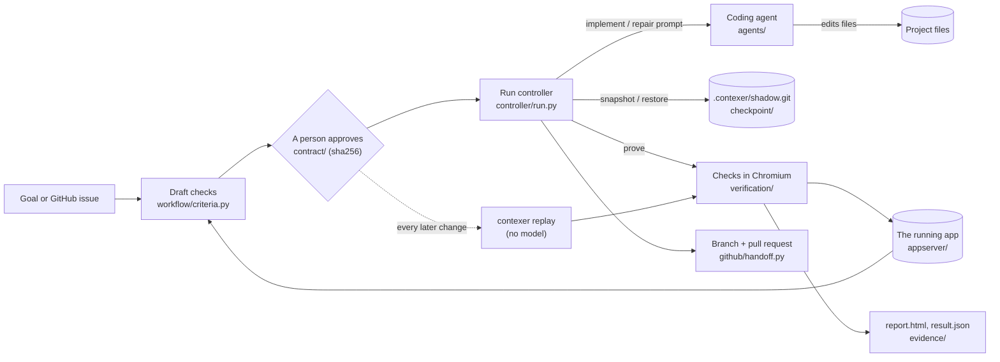
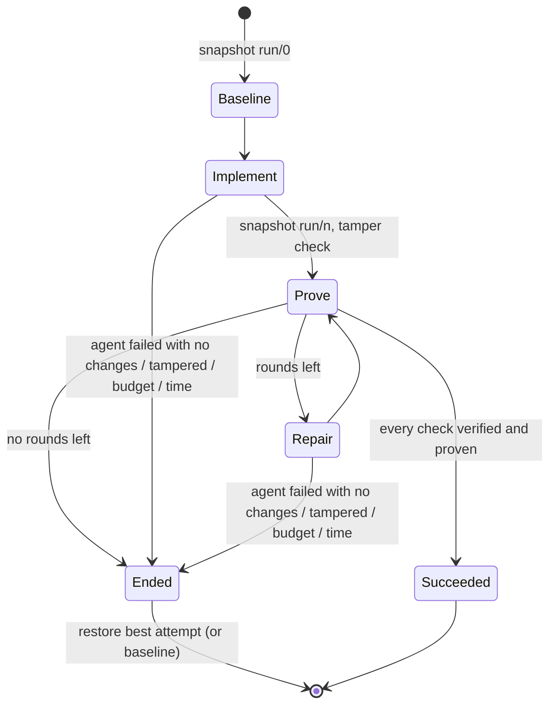
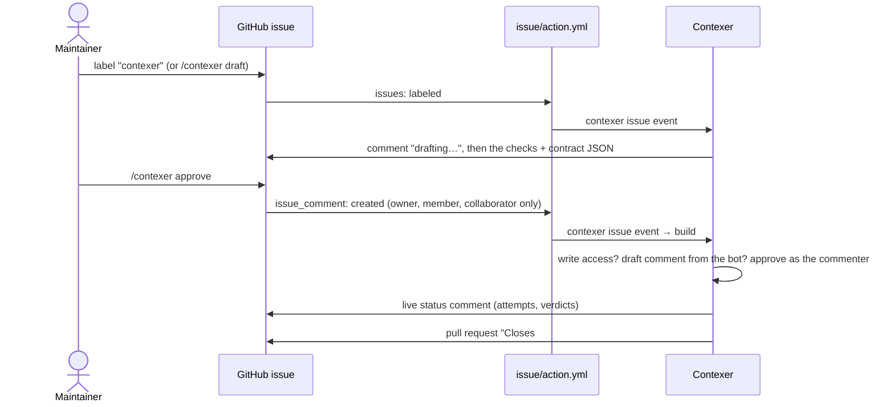

# Contexer architecture

This is the technical reference for how Contexer works, module by module: what
each part does, the data it reads and writes, the decisions it makes, and the
constants that govern them. It describes version 0.4.0 as it is in the code.
Product reasoning is in [product-plan.md](product-plan.md), the build history
in [roadmap.md](roadmap.md), and day-to-day use in [try-it.md](try-it.md).

Paths are relative to `contexer-agent/src/contexer/` unless they start with
`contexer-agent/` or the repository root.

## Contents

1. [Principles](#1-principles)
2. [System overview](#2-system-overview)
3. [Repository and package layout](#3-repository-and-package-layout)
4. [Data model](#4-data-model)
5. [The check language](#5-the-check-language)
6. [Proving checks in a browser](#6-proving-checks-in-a-browser)
7. [Starting the app](#7-starting-the-app)
8. [Drafting checks from a goal](#8-drafting-checks-from-a-goal)
9. [The run controller](#9-the-run-controller)
10. [Snapshots](#10-snapshots)
11. [Coding agent adapters](#11-coding-agent-adapters)
12. [Models and bring your own key](#12-models-and-bring-your-own-key)
13. [Evidence](#13-evidence)
14. [GitHub](#14-github)
15. [The command line](#15-the-command-line)
16. [Configuration reference](#16-configuration-reference)
17. [Security model](#17-security-model)
18. [Benchmark](#18-benchmark)
19. [CI, the actions and releases](#19-ci-the-actions-and-releases)
20. [The interactive shell and other modules](#20-the-interactive-shell-and-other-modules)
21. [Tests](#21-tests)
22. [Extending Contexer](#22-extending-contexer)
23. [Known limits](#23-known-limits)

## 1. Principles

1. **Rent the agents, own the verdict.** Contexer writes the contract, the
   verdict, the repair controller and the evidence. Coding agents (Claude
   Code, Codex, OpenCode) and models are dependencies behind adapters.
2. **The agent's word never counts.** An agent turn's report is stored, never
   used as a pass. Changed files come from Contexer's own snapshots.
3. **Deterministic code owns control flow.** The agent is called for exactly
   two things, implementing and repairing, inside a loop Contexer controls.
4. **Replays need no model.** An approved contract runs with zero model calls.
5. **Fail safe.** Anything undecided blocks (`needs_action`); nothing reports
   a quiet pass.
6. **Measured before claimed.** Accuracy claims come from `contexer bench`.

## 2. System overview



A `contexer run "GOAL" --pr`, end to end:

1. **Checks before spending anything** (`cli/run_cli.py`): refuse a home
   folder or drive root (`checkpoint/shadow.py: unsafe_work_tree`); with
   `--pr`, check the git checkout (`github/handoff.py: plan_handoff`); load
   the project's `.env` and `contexer.toml`; choose the agent; with `--issue`,
   read the issue; check OpenRouter's free requests when a free model is in
   use (`check_free_quota`).
2. **Draft** (`_draft`): start the app, take its ARIA snapshot, have the model
   compile the goal into a contract, then try the draft once on the app as it
   is (`preview_draft`).
3. **Approve** (`_approve`): show the checklist and the preview, ask, and on
   yes store the approval with the contract's sha256.
4. **Run** (`execute_run` → `RunController.run`): snapshot, implement, prove,
   repair up to the limit, keep the best attempt, write the evidence.
5. **Hand off** (`hand_off`): branch, commit, push, pull request.
6. **Report** (`_render`): one aligned summary, exit code from the outcome.

## 3. Repository and package layout

```text
<repository>/
  contexer-agent/            the Python package (published to PyPI as contexer-agent)
    src/contexer/            the code (below)
    tests/                   pytest suite
    bench/fixtures/          seeded-bug benchmark apps
    docs/                    product plan, roadmap, landscape, this file, try-it guide
    pyproject.toml PYPI.md CHANGELOG.md LICENSE THIRD_PARTY_NOTICES.md .env.example
  action.yml                 the acceptance-gate GitHub Action (composite)
  issue/action.yml           the issue-agent GitHub Action (composite)
  .github/workflows/         ci.yml, acceptance-gate.yml, release.yml
  website/                   the landing page (Next.js 16, Tailwind 4, static)
  marketing/                 launch kit and the Remotion launch video
  .agents/skills/            agent skills used to build this repository (ui-skills etc.)
```

| Package | Responsibility |
| --- | --- |
| `cli/` | The commands. `term.py` is the shared terminal design; `run_cli`, `gate_cli` (verify, replay, contract), `issue_cli`, `setup_cli` (setup, models), `doctor_cli`, `demo_cli`, `init_cli`, `runs_cli` (runs, restore), `bench_cli`. `repl.py`, `commands.py`, `ui.py` are the interactive shell |
| `contract/` | `Contract` model, canonical hash, approval, file store |
| `verification/` | The check language (`checks.py`), the Playwright runner (`runner.py`), the verifier (`verifier.py`), result models |
| `observer/` | Page observation: ARIA snapshot, password masking, Chromium status |
| `gate/` | `GateDecision`, `RunResult`, the decision rules (`decision.py`) and `VerificationSession` |
| `appserver/` | Start-plan detection, the dev server, `open_app`, `[app] reset`, Windows Job Objects |
| `agents/` | `CodingAgentAdapter` and the Claude Code, Codex, OpenCode and scripted adapters |
| `opencode/` | HTTP client and adapter for `opencode serve` |
| `checkpoint/` | Shadow-git snapshots and restores |
| `controller/` | The run state machine and the agent prompts |
| `evidence/` | Run directories, `report.html`, `result.json` |
| `github/` | Commit status and job summary, the REST client, the pull-request hand-off, the issue flow |
| `llm/` | Provider catalog, model discovery, provider clients, structured-output parsing |
| `config/` | Environment settings, `contexer.toml`, per-user settings in `~/.contexer` |
| `workflow/` | Goal-to-checks compiler (`criteria.py`), repository inspector, static file server |
| `bench/` | The seeded-bug benchmark runner |
| `demo/` | The `contexer demo` todo app and its contract |
| `procutil.py` | Process trees that are always stopped together |
| `runtime/`, `tools/`, `safety/`, `state/`, `context/`, `mcp/`, `project/` | The interactive shell's agent loop ([§20](#20-the-interactive-shell-and-other-modules)) |

Runtime dependencies: `typer`, `rich` (<14), `openai` (the OpenAI-compatible
client), `pydantic` 2, `python-dotenv`, `httpx`, `playwright` (≥1.49, for
`Locator.aria_snapshot`). Python 3.11 or newer. The Anthropic client is plain
`httpx`, so there is no `anthropic` dependency.

## 4. Data model

### Files in a project

```text
<project>/
  contexer.toml                     optional settings (§16)
  .env                              optional keys and [auth] secrets (never committed)
  .contexer/
    .gitignore                      "/*  !/.gitignore  !/contracts/": only contracts are committed
    contracts/<id>.json             contracts (commit these)
    runs/<run-id>/                  evidence for one verify or run (§13)
    shadow.git/                     private snapshot repository (§10)
```

### Contract (`contract/models.py`)

```json
{
  "version": 1,
  "id": "todo-basics",
  "goal": "Users can add, complete and delete tasks, and the remaining count stays correct",
  "summary": "...",
  "criteria": [
    {"id": "complete-decrements", "description": "Completing a task lowers the remaining count",
     "verification_method": "interactive_test",
     "check": {"steps": [...], "expect": [...]}}
  ],
  "source": "llm | rules | user",
  "created_at": "2026-10-15T10:00:00Z",
  "approval": {"by": "murtuza777", "at": "...", "sha256": "40740b37aeef..."}
}
```

- **Hash** (`content_hash`): SHA-256 of canonical JSON (`sort_keys`, compact
  separators, `ensure_ascii=False`) over `goal` and each criterion's `id`,
  `description`, `verification_method` and `check` (by alias, nulls
  excluded). `summary`, `source` and dates are not hashed.
- **Status**: `draft` (no approval), `approved` (hash matches), `modified`
  (approved, but the content changed since). A modified contract never runs
  as approved.
- **Ids**: `slugify` keeps up to 6 words without stop words (`"contract"` if
  none); `ContractStore.unique_id` appends `-2`, `-3`.
- **Approver**: `--by`, else `git config user.name`, else `USER`/`USERNAME`,
  else `unknown`. The issue flow records the approving GitHub login.

### Verdicts and outcomes

| Verdict (per check) | Rule (`verification/models.py`) |
| --- | --- |
| `verified` | The check passed |
| `unverified` | A step could not act (`blocked`) or a step failed: nothing was decided |
| `refuted` | The steps ran and an expectation was observed to fail |

Each verdict carries its method: `proven` (`method == "assertion"`, executed
in the browser), `LLM-judged` (`judgment`) or `heuristic` (keyword matching,
confidence capped at 0.6). Only proven verdicts gate, plus judged ones when
`[gate] judged = "block"`.

Gate outcome (`gate/decision.py`), most severe wins: `error` (the app or a
step of Contexer failed) > `fail` (a gating check refuted) > `needs_action`
(anything unverified, a draft or modified contract where approval is
required, or a contract with no gating results) > `pass`.

### Exit codes

| Code | Meaning |
| --- | --- |
| `0` | pass / run succeeded |
| `1` | fail: a check was refuted / run ended on failing checks |
| `2` | needs action: unverified checks, draft or modified contract, budget or time used up, tampering, not approved |
| `3` | error: the app or the agent could not run, a pull request could not be prepared, no free requests left |
| `130` | stopped with Ctrl+C |

## 5. The check language

Defined in `verification/checks.py`. A check is a list of steps then a list
of expectations (`expect` needs at least one), run in a fresh browser.

**Targets** (`Locator`): exactly one strategy of `role`, `text`, `label`,
`placeholder`, `test_id`, `css`. `name` only goes with `role`, and `role` must
be an ARIA role. Aliases: `selector`→`css`; `testid`, `testId`, `data-testid`
→`test_id`; roles `a`→`link`, `input`/`textarea`→`textbox`,
`select`/`dropdown`→`combobox`, `image`→`img`, `nav`→`navigation`, `h1`–`h6`
→`heading`. A `role`+`name` target also matches a role element whose visible
text contains the name; the first visible match is used (at most 20 scanned).

**Steps**: `click`, `fill`, `press`, `select`, `check`, `uncheck`, `hover`,
`wait`, `goto`. Target required for click, fill, select, check, uncheck,
hover; value required for fill, select, press, wait, goto. `wait` is whole
milliseconds up to 10,000.

**Expectations**: `visible`, `hidden`, `checked`, `unchecked`, `count`
(`min`/`max`), `text`, `value`, `attribute`, `css` (`property`), `url`,
`title`, `no_errors`. Comparators, ANDed: `equals` (exact after whitespace
normalisation), `contains` (case-insensitive), `matches` (regex), `changed`
(differs from the value read before the steps ran). `attribute "checked"` is
rewritten to `checked`/`unchecked`.

**Sign-in**: `login` unset follows the project (signed in when `[auth]`
exists), `false` runs signed out, `true` requires a signed-in session.

**Secrets**: `${NAME}` in step values (pattern `[A-Za-z_][A-Za-z0-9_]*`) is
expanded from the environment at run time; an unset name fails the check
before it navigates (`MissingSecretError`). Expanded values are redacted to
`••••••` (longest first, values of 3+ characters) in the failed step, the UI
snapshot, page and console errors and each outcome.

**Failure report** (`CheckResult.failure_report`): `[id] executable check
BLOCKED|FAILED`, what could not be performed, up to 20 lines of what the page
offered instead, expected/actual for each failed expectation, and the first 3
uncaught exceptions. This text goes to the person and to the repair prompt.

## 6. Proving checks in a browser

### CheckRunner (`verification/runner.py`)

| Setting | Default |
| --- | --- |
| headless | `True` |
| navigation timeout | 15 s |
| action timeout | 3 s |
| expectation timeout | 2 s (polled every 0.1 s) |
| settle after steps | 250 ms |
| traces | `off` (`on`, `on-failure`) |

- One Chromium per run; each check gets a new context (viewport 1280×800,
  HTTPS errors ignored), with the signed-in `storage_state` unless the check
  says `login: false`.
- `timeout_scale` multiplies the navigation, action and expectation timeouts
  (not the settle time).
- `before_each` (the `[app] reset`) runs before every check; a failure blocks
  that check as unverified, never refuted.
- Execution (`_exercise`): `goto` with `wait_until="load"`, read baselines for
  `changed` comparators, run the steps, settle, then evaluate expectations.
  A missing or hidden target makes the check `blocked` with an ARIA snapshot
  of what the page offered; a target that was there but did not respond is
  a refutation.
- Page errors (`pageerror`) and console errors (`console` of type `error`,
  ignoring `/favicon.ico`) are collected; `no_errors` is evaluated last so
  late asynchronous exceptions count.
- Evidence: a JPEG screenshot per check (quality 70); a trace only when
  `trace != "off"`, and never for a signed-in check unless `trace == "on"`,
  because a trace records the session cookie.

### Sign-in (`[auth]`)

`CheckRunner.sign_in` runs the `[auth]` steps once per verification and keeps
`context.storage_state()` (cookies and local storage) in memory only. On
failure it raises `SignInError` with what did not hold, the final URL, any
`role=alert` text and a `sign-in.jpg`, with every typed value redacted; the
verification ends as an error. `sessionStorage` is not carried over.

### Observation (`observer/playwright.py`)

Before drafting, Contexer loads the app (`domcontentloaded`, 15 s, then
500 ms), and records the status, title, text, up to 40 interactive elements,
h1–h3 headings, errors and a screenshot. `capture_ui_snapshot` takes
`body.aria_snapshot()` plus `data-testid` and placeholder extras (up to 60),
cut at 4,000 characters. Password input values in the snapshot are replaced
with `••••••` before the snapshot goes anywhere.

### Verifier and session

`verification/verifier.py`: criteria with a check run as assertions; without
one, a model judges if one is available, else keyword heuristics. A page that
failed to load or answered HTTP 400+ fails at once.

`gate/session.py: VerificationSession` ties it together per run: `observe`,
`compile` (grounded in the snapshot), `verify` (per contract, evidence in
`runs/<id>/checks/<contract>/`, reset before each check, and for dev servers
`timeout_scale = 2.5` with a 60 s first load, because pages compile on first
use), and `result`.

## 7. Starting the app

`appserver/app.py: open_app` is a context manager that yields a `RunningApp`
(`url`, `kind`, `repo_context`, `log_tail`, `command`, `server`):

1. `--url` → `external`: used as is.
2. A static site without `[app] start` → `static`: `workflow/app_server.py`,
   a threaded HTTP server on `127.0.0.1`, OS-assigned port,
   `Cache-Control: no-store`. A static site has an `index.html` and no
   `package.json`, `pyproject.toml`, `requirements.txt` or `manage.py`.
3. Otherwise → `dev`: a start plan and a `DevServer`.

Every start failure becomes `AppStartError` with the log tail; the server is
always stopped on exit.

### Start plan (`appserver/detect.py`)

- `[app] start` wins: `{port}` is replaced (configured or a free port), run
  through the shell (`cmd.exe /d /s /c` or `/bin/sh -c`), `PORT` set.
- Else `package.json`: the first of the `dev`, `start`, `serve`, `preview`
  scripts. A port already pinned in the script is used as is.
- Framework (from the script, then dependencies): Next.js (`-p N -H
  127.0.0.1`), Astro and Nuxt (`--port N --host 127.0.0.1`), Vite (`--port N
  --strictPort --host 127.0.0.1`), CRA and others (environment only). npm puts
  `--` before the flags. Environment: `PORT`, `BROWSER=none`,
  `HOST=127.0.0.1`, plus `[app] env`.
- Package manager: the `packageManager` field, else the lockfile (`pnpm`,
  `yarn`, `bun`), else npm. Install: `npm ci` with `package-lock.json`, `pnpm
  install --frozen-lockfile` with `pnpm-lock.yaml`, else `<manager> install`;
  only when `[app] install` is true.

### Dev server (`appserver/devserver.py`)

- Installs when `node_modules` is missing (or on request; 900 s limit), then
  spawns the start command as a process tree (§procutil) with `FORCE_COLOR=0`
  and `CI=1`.
- Output goes to `server.log` and a 400-line ring buffer (ANSI stripped).
- Ready when the port answers 200–399 or 400–403 (Playwright `webServer`
  semantics), polled every 0.5 s up to `ready_timeout` (120 s), on both
  `127.0.0.1` and `localhost`, also trying any port the log announces. An
  early exit raises with the log tail.
- The run controller restarts with a reinstall when an attempt (or a revert)
  changes `package.json` or a lockfile (`_DEPENDENCY_FILES`).

### `[app] reset` (`appserver/reset.py`)

A shell command run before every check (120 s limit), with `{url}` and
`{port}` filled in. Checks share the app's server, so data one check saves is
there for the next; the reset puts it back. A failing reset blocks its check.

### Process trees (`procutil.py`)

- **Windows**: the child starts `CREATE_SUSPENDED` (plus
  `CREATE_NEW_PROCESS_GROUP | CREATE_NO_WINDOW`), is assigned to a
  kill-on-close Job Object (`appserver/winjob.py`, `JOB_OBJECT_LIMIT_KILL_ON
  _JOB_CLOSE`), then resumed with `NtResumeProcess`. Starting suspended stops a
  launcher such as `opencode.cmd` from spawning children before it is in the
  job. Without a job, `taskkill /T /F` is the fallback.
- **POSIX**: a new session; the whole process group gets `SIGTERM`, then
  `SIGKILL` after the grace period.
- `ProcessTree.kill` is lock-protected, so Ctrl+C and a worker thread can both
  call it.
- `popen_args`: a `cmd.exe /d /s /c X` command is passed as one string so
  quoted paths survive `cmd.exe`'s own parsing.

## 8. Drafting checks from a goal

`workflow/criteria.py: GoalAnalyzer.analyze(goal, repo_context, ui_snapshot)`:

- **Prompt**: a QA-architect brief asking for 4–10 criteria, the goal, the
  project summary (`RepositoryInspector.format_summary`), the live ARIA
  snapshot with the rule that existing elements must be located exactly as
  listed (or, with no rendered UI, that every locator becomes part of the
  contract), a source excerpt used only to learn locators, and
  `CHECK_DSL_GUIDE`. The model must reply with JSON (`summary`,
  `acceptance_criteria`).
- **The guide's rules**: prefer role+name, then text, then label/placeholder,
  then test id, CSS last; one behaviour per check; exact values; verify by
  interacting; each check runs alone in a fresh browser; checks start signed
  in (`"login": false` for signed-out behaviour); server data is shared, so
  created items get unique names that include the criterion id; cover edge
  cases (repeat, toggle back, edit one of many, form rules), each with
  `no_errors`; omit `check` only for criteria a browser cannot decide.
- **Attempts**: at most 2, each capped at 180 s. The first asks for JSON mode,
  the second does not. The better attempt by executable coverage is kept,
  stopping once at least 50% of criteria are executable. A 429 or rate limit
  stops retrying. `last_error` keeps the reason, `drafted_by` the model that
  actually answered.
- **Fallback**: with no usable reply, simple rules produce a draft
  (`source = "rules"`): a runtime check, keyword criteria and visible-text
  checks for quoted text. `--yes` never approves such a draft, and the CLI
  shows it as a "Weak draft".
- **Parsing** (`llm/structured.py`): strip `<think>` blocks, try the first
  fenced block, then the whole text, then every `{` with `raw_decode`,
  preferring objects with the expected key. Invalid checks are dropped.
- **Runtime check**: an LLM draft always gets a `no_errors` criterion
  (`crit-runtime`) if it has none.

**Preview** (`cli/gate_cli.py: preview_draft`): the draft runs once on the app
as it is, and the person sees which checks already pass (they will guard that
behaviour), which fail (the change must make them pass, or the check is
wrong) and which cannot run yet. When every check already passes, the person
is warned the checks may not test anything new.

**Repository inspector** (`workflow/inspector.py`): frameworks from
`package.json` (Next.js, Vite, React, Vue, Svelte, Node) or Python files
(FastAPI, Flask, Django), entry points, up to 50 key files, and a source
excerpt of up to 8,000 characters (entry points first; `.html`, `.js`,
`.mjs`, `.jsx`, `.ts`, `.tsx`, `.vue`, `.svelte`).

## 9. The run controller

`controller/run.py: RunController.run(contract, others)`. The contract must be
approved; `others` are the other approved contracts, replayed as regression
checks unless `--no-replay`.

| Setting (`RunSettings`) | Default | Source |
| --- | --- | --- |
| `max_repair_rounds` | 2 | `--rounds`, `[agent] max_repair_rounds` |
| `budget_usd` | none | `--budget`, `[agent] budget_usd` |
| `turn_timeout` | 900 s | `[agent] turn_timeout` |
| `wall_clock` | 3600 s | — |
| `judged_policy` | `advisory` | `[gate] judged` |



Per attempt *n*:

1. **Agent turn**: implement (attempt 1) or repair, with the remaining budget
   and `turn_timeout`. The session is resumed unless a fresh one is needed.
2. **Tamper guard** (`_ContractGuard`): the contract files are compared with
   the bytes saved at the start; any change is put back and the run ends
   `tampered`.
3. **Snapshot** `refs/contexer/<run>/<n>`; changed files are the diff against
   the previous state the agent started from.
4. **Agent failure**: a failed turn with no changes ends the run
   (`agent_error`, or `budget_exhausted` when the budget ran out).
5. **Prove**: start the app once (`open_app`), or restart with a reinstall if
   dependencies changed, or `ensure_running`. An app that does not start
   becomes an `error` attempt whose log goes into the repair prompt. Otherwise
   all checks run (target plus regression contracts) in
   `runs/<run>/attempt-<n>/`.
6. **Score** (`_score`): +1 per proven verified check of the target contract,
   −2 per proven refuted check of another contract (a regression costs double),
   −1,000,000 for an attempt where the app did not run.
7. **Keep the best**: a better-scoring usable attempt becomes the best; a
   worse one is reverted to the best (`shadow.restore`), reinstalling if the
   revert changes dependencies.
8. **Signatures** (`_signatures`): for each proven, not-verified check,
   SHA-1 (10 hex) of the verdict, the failed expectations with their actual
   values, the failed step and the first page error. If a signature survives
   a repair unchanged, or the attempt was reverted, the next repair starts a
   fresh agent session focused on that failure.
9. **Repair prompt** (`controller/prompts.py: repair_prompt`): the app-start
   error or reasons, a failure bundle per failing proven check (failed step,
   expected vs actual, up to 3 exceptions and 3 console errors, and when
   blocked up to 25 lines of what the page offered), the checks already
   passing (keep them passing), the last 25 server-log lines, a revert notice,
   and the repeated failures.

**Terminal states**: `succeeded`, `failed_checks`, `needs_human` (only
unverified checks, or the app did not start, after the last round),
`budget_exhausted`, `timed_out`, `tampered`, `agent_error`, `app_error`,
`cancelled`.

**End state**: a successful run leaves the last attempt. Otherwise the best
attempt is restored; with no usable attempt the baseline comes back. A
tampered run restores the best attempt or the baseline. The project is never
left worse than it was found.

**Ctrl+C** (`on_exit`, registered first on the `ExitStack` so it runs after
the app has stopped): the agent's process tree is killed (or the OpenCode
session aborted), the unfinished work is snapshotted as
`refs/contexer/<run>/stopped`, the best attempt or the baseline is restored,
the evidence is written with the outcome `cancelled`, and the command exits
130. `contexer restore <run> --stopped` brings the unfinished work back.

**Implement prompt** (`implement_prompt`): the checks, not the agent's
judgement, decide when the work is done; the goal; the contract "executed
verbatim"; the other approved goals that must keep working; the project
summary; and the rules: smallest complete change using the exact names the
checks reference; do not start a dev server; do not install Playwright or
browsers or write end-to-end tests; do not touch `.contexer/`; do not commit,
push or rewrite history; no uncaught exceptions; reply with a short summary.

## 10. Snapshots

`checkpoint/shadow.py: ShadowRepo` is a private git repository at
`.contexer/shadow.git` whose work tree is the project:

- It works in folders that are not git repositories and never touches the
  user's `.git`, branches, index or stash (`GIT_DIR`/`GIT_WORK_TREE` are set
  per command; `GIT_INDEX_FILE` removed).
- Config: `core.autocrlf=false`, `core.safecrlf=false` (byte-exact),
  `core.longpaths=true`, `gc.auto=0`. `info/exclude`: `/.contexer/`,
  `node_modules/`, `.next/`, `.nuxt/`, `.svelte-kit/`, `.turbo/`, `.vercel/`,
  `.cache/`, `dist/`, `coverage/`, `.venv/`, `venv/`, `__pycache__/`, `*.log`.
  The project's own `.gitignore` files apply too, so `.env` is never
  snapshotted or restored.
- `snapshot(ref)`: `add --all`, `write-tree`, `commit-tree` (no parent), and
  `update-ref refs/contexer/<ref>`.
- `restore(commit)`: index the current state first (so files created since
  are known), then `read-tree -u --reset`: created files are removed, ignored
  files are left alone.
- `changed_paths` (`diff --name-only --no-renames`), `diff` (stat and patch,
  cut at 200,000 characters), `resolve(ref)`.
- `unsafe_work_tree` refuses a drive root or the home folder.

Refs per run: `<run>/0` (baseline), `<run>/<n>` (attempts), `<run>/stopped`,
`<run>/undo` (before a `contexer restore`).

## 11. Coding agent adapters

`agents/base.py: CodingAgentAdapter.run_turn(workdir, prompt, *, session_id,
timeout, budget_usd, on_progress) -> AgentTurn` with `status`
(`completed`, `failed`, `timeout`, `budget_exceeded`, `cancelled`),
`session_id`, `summary`, `error`, `cost_usd`, `duration_seconds`,
`num_turns`, `tool_calls`, `files_touched`, `permission_denials`. The turn is
informational only. Process-based adapters track their running trees
(`_track`/`_untrack`); `stop()` kills them, and `close()` calls `stop()`.

| Adapter | How it runs |
| --- | --- |
| Claude Code (`claude_code.py`) | `claude -p --output-format stream-json --verbose --permission-mode acceptEdits` with an allowed-tools list (Read, Edit, MultiEdit, Write, Glob, Grep, LS, TodoWrite, package installs, `npx tsc`, `npm run build/lint`, `ls`, `git status/diff`) and denied tools (`Edit/MultiEdit/Write(.contexer/**)`, `git commit/push/reset/checkout`, `rm -rf`); `--max-budget-usd`, `--model`, `--resume <session>`. The prompt goes to stdin; NDJSON events are parsed for progress, cost and the final `result` |
| Codex (`codex_agent.py`) | `codex exec --json --skip-git-repo-check --sandbox workspace-write --config approval_policy="never" --config sandbox_workspace_write.network_access=true --cd <dir> [--model] -`, and `resume <thread_id> -` for repairs. Only `turn.completed` / `turn.failed` end a turn. Codex reports no cost, so `--budget` does not apply |
| OpenCode (`opencode_agent.py`) | Talks to `opencode serve` over HTTP (`OPENCODE_SERVER_URL`, default `http://127.0.0.1:4096`), starting it if `/global/health` does not answer (60 s). A session per run; tool calls are polled every 2 s for progress. On a timeout or Ctrl+C the session is aborted. With `OPENROUTER_API_KEY` and no model chosen it uses `openrouter/nvidia/nemotron-3-ultra-550b-a55b:free` |
| Scripted (`scripted.py`) | Applies queued file writes per turn (`None` deletes). `--agent scripted --model turns.json` reads them from a JSON list; used by tests and to try a setup without a model |

Claude Code and Codex run in a worker thread; on cancellation the tree is
killed so the thread (and Python's executor shutdown) does not wait for the
turn. Agent processes get the user's environment minus a parent Claude
session's plumbing and minus every repository token (`GITHUB_TOKEN`,
`GH_TOKEN`, `CONTEXER_GITHUB_TOKEN`, `ACTIONS_RUNTIME_TOKEN`,
`ACTIONS_ID_TOKEN_REQUEST_*`), with `CI=1`.

Agent choice (`cli/run_cli.py: choose_agent`): `--agent`, then `[agent] name`
if set in `contexer.toml`, then `CONTEXER_AGENT` (from `contexer setup`),
then `claude-code`. The model: `--model`, then `[agent] model`, then
`CONTEXER_AGENT_MODEL` when it was saved for that agent.

## 12. Models and bring your own key

### Provider catalog (`llm/catalog.py`)

`ProviderSpec(id, label, key_env, keys_url, protocol, base_url,
default_model, opencode_id, native_agent, local, note)`:

| Id | Key variable | Base URL | Default model | Native agent |
| --- | --- | --- | --- | --- |
| `openrouter` | `OPENROUTER_API_KEY` | openrouter.ai/api/v1 | `nvidia/nemotron-3-ultra-550b-a55b:free` | — |
| `anthropic` | `ANTHROPIC_API_KEY` | api.anthropic.com/v1 (Anthropic protocol) | `claude-opus-5-5` | Claude Code |
| `openai` | `OPENAI_API_KEY` | api.openai.com/v1 | `gpt-5` | Codex |
| `google` | `GEMINI_API_KEY` | generativelanguage.googleapis.com/v1beta/openai | — | — |
| `groq` | `GROQ_API_KEY` | api.groq.com/openai/v1 | — | — |
| `deepseek` | `DEEPSEEK_API_KEY` | api.deepseek.com | — | — |
| `mistral` | `MISTRAL_API_KEY` | api.mistral.ai/v1 | — | — |
| `togetherai` | `TOGETHER_API_KEY` | api.together.xyz/v1 | — | — |
| `xai` | `XAI_API_KEY` | api.x.ai/v1 | — | — |
| `fireworks-ai` | `FIREWORKS_API_KEY` | api.fireworks.ai/inference/v1 | — | — |
| `cerebras` | `CEREBRAS_API_KEY` | api.cerebras.ai/v1 | — | — |
| `nvidia` | `NVIDIA_API_KEY` | integrate.api.nvidia.com/v1 | — | — |
| `ollama` | `OLLAMA_API_KEY` | localhost:11434/v1 (local, no key needed) | — | — |
| `custom` | `CONTEXER_CUSTOM_API_KEY` | `--base-url` | — | — |

Providers without a native agent build through OpenCode as
`<opencode_id>/<model>`.

### Clients

- `llm/openrouter.py: OpenAICompatibleProvider` (the `openai` SDK) serves every
  OpenAI-protocol provider (`for_spec`). It reports the model that actually
  answered (`response.model`). Errors map to `LLMAuthenticationError` (401,
  bad key), `LLMRateLimitError` (429, quota, credits),
  `LLMModelUnavailableError` (404), `LLMNetworkError` and `LLMError`, with the
  key scrubbed from messages.
- `OpenRouterProvider`: when the model is the default, the request carries
  `extra_body={"models": [default, "openrouter/free"]}` so OpenRouter falls
  back to its free router; a model the user picked is used as given.
- `llm/anthropic.py`: plain `httpx` to `/v1/messages` (`anthropic-version:
  2023-06-01`, 16,000 max tokens, 300 s), no tool calling.

### Choosing the drafting model (`llm/factory.py`)

1. `[compiler] provider` / `model` in `contexer.toml`.
2. `CONTEXER_LLM_PROVIDER` (what `contexer setup` saved).
3. The first of `anthropic`, `openai`, `openrouter` with a key, then any other
   keyed catalog provider with a default model, whose configuration is valid.

The model for a provider: an explicit argument, then `CONTEXER_LLM_MODEL` only
if that provider is the one named in `CONTEXER_LLM_PROVIDER` (the "paired"
rule: a provider never inherits another's model or base URL), then the
provider's own variable (`OPENROUTER_MODEL`, `OPENAI_MODEL`,
`ANTHROPIC_MODEL`), then the catalog default.

### Discovery (`llm/discovery.py`)

- `list_models`: `GET {base}/models`, newest first; free when both prices are
  zero or the id ends in `:free`; tool support from `supported_parameters`.
- `check_key`: OpenRouter's model list is public, so its key is checked with
  `GET /key`; other providers by listing models. 401/403 means "rejected the
  key", never echoing it.
- `try_model`: one tiny request ("Reply with the single word: ok"); `contexer
  setup` saves nothing unless it answers.
- `openrouter_free_quota`: `GET /key` → `free_model_daily_requests`
  (`used`, `limit`, `remaining`). `contexer run` stops when none are left and
  asks when fewer than 25 (`LOW_FREE_REQUESTS`) remain; `doctor` shows it.

### User settings (`config/user.py`)

- `~/.contexer/` (or `CONTEXER_HOME`): `config.toml` (`[model]` provider,
  model, base URL; `[agent]` name, model) and `credentials.toml` (`[keys]`,
  mode 0600 on POSIX).
- Precedence: exported variables, then the project's `.env`, then what
  `contexer setup` saved, then `contexer.toml` for the settings it covers.
  `apply_user_settings` fills only unset variables and records what it set,
  so a project's `.env` loaded later (`--dir` elsewhere) can replace exactly
  those values.
- `contexer setup` flow: provider → key (hidden input, or reuse an existing
  one) → `check_key` → model from the provider's list (OpenRouter suggests
  free models with tools) → `try_model` → coding agent (the provider's native
  agent if installed, else OpenCode) → save → check Chromium and offer to
  install it.

## 13. Evidence

`evidence/rundir.py`: run ids are `%Y%m%d-%H%M%S-<4 hex>`; everything for a
run is in `.contexer/runs/<run-id>/`:

```text
report.html            self-contained report (inline CSS, screenshots as data URIs)
result.json            the RunResult, without the page's HTML, text and base64 screenshot
run.json               contexer run only: the whole RunOutcome (attempts, agent turns, diff, cost)
server.log             the dev server's output
checks/<contract>/     per-check screenshots (and traces when kept)
attempt-<n>/           contexer run: the same, per attempt
sign-in.jpg            when sign-in failed
observation_*.png      the page as observed before drafting
```

`report.html` (`evidence/report.py`): a header with the verdict and counts
(verified, refuted, unverified, advisory), app, start, duration, mode and run
id; up to 30 reasons; for `contexer run` the attempts table; a card per
contract, failures first, with each check's mark, `proven` or `LLM-judged`
tag, steps, expected vs actual, up to 5 exceptions, what the page offered
instead, the screenshot and the trace path; the loaded page; and the last 80
server-log lines.

## 14. GitHub

### Commit status and job summary (`github/status.py`)

`contexer replay --github` posts `contexer/acceptance` on the commit (the pull
request's head SHA from `GITHUB_EVENT_PATH`, else `GITHUB_SHA`, else `git
rev-parse HEAD`): `pass`→`success`, `fail` and `needs_action`→`failure`
(statuses have no neutral, and a required check must not pass quietly),
`error`→`error`, with a description of at most 140 characters and a link to
the workflow run. In Actions it also writes a per-check markdown table to
`$GITHUB_STEP_SUMMARY`.

### REST client and token (`github/api.py`)

`GitHubClient` (httpx, API version 2022-11-28): issues, issue comments (paged,
100 per page), comment edits, collaborator permission, and pull requests. The
token comes from `CONTEXER_GITHUB_TOKEN` (a personal or app token, so pull
requests Contexer opens in Actions start other workflows), `GITHUB_TOKEN`,
`GH_TOKEN`, then `gh auth token`. The repository comes from
`GITHUB_REPOSITORY`, else the `origin` remote URL.

### Pull-request hand-off (`github/handoff.py`)

`plan_handoff(project)`, before anything is spent: a git repository with a
commit, on a branch (not detached), with no uncommitted changes to tracked
files; the remote (`origin`, else the first) and its GitHub repository.

`hand_off(plan, outcome, contract, issue)` after the run, unless it was
tampered or cancelled, and only when files changed:

1. Branch `contexer/<contract-id>` (`-2`, `-3` if taken locally or on the
   remote), switched to with the working changes.
2. `git add --all -- <changed files> <contract file>`: exactly the files the
   run changed (from the shadow diff) plus the approved contract, unless the
   project's `.gitignore` ignores it. Monorepo projects use paths from the
   repository root. The user's other untracked files stay out.
3. Commit with the goal as subject (cut at a word boundary, 72 characters) and
   the proof in the body; a fallback identity `Contexer
   <contexer@users.noreply.github.com>` only when git has none. A failing
   pre-commit hook leaves the changes staged and says so.
4. Push with `--set-upstream` (`GIT_TERMINAL_PROMPT=0`); in Actions the token
   is passed as an `http.<server>/.extraheader`, so nothing is stored in
   `.git/config`.
5. Open the pull request: ready for review when the run succeeded, a draft
   otherwise; where drafts are not supported, a normal one titled
   `[Draft] ...`; an existing one for the branch is reused. Without a token,
   the result is the compare link.

The description (`pull_request_body`): the outcome, the goal, the checklist
with each verdict and evidence, the regression replay count, the agent,
attempts, repair rounds, cost and duration, the contract and its approval
hash, where the evidence is (the workflow run's artifact in Actions), and
`Closes #N` for issue runs. You are left on the new branch.

### Issue flow (`github/issues.py`, `cli/issue_cli.py`, `issue/action.yml`)



- `command_for(event)`: `issues: labeled` with the label → draft;
  `issue_comment: created` starting with `/contexer draft` → draft,
  `/contexer approve` or `/contexer build` → build; comments on pull requests
  and anything else → ignore. `contexer issue event --plan` prints it (and
  writes `command=` to `GITHUB_OUTPUT`) so the action installs the coding
  agent only for builds.
- **Draft comment**: `<!-- contexer:draft id=<id> sha256=<hash> -->`, the
  checks with how each fares on the app today, and the contract as JSON inside
  `<details>`. A maintainer may edit the JSON; the build notices
  (`edited since drafting`).
- **Build**: the approver must have `admin`, `maintain` or `write` access
  (checked through the API); only a comment by a `Bot` user counts as the
  draft, so a person's imitation is ignored; the contract is approved in the
  approver's name; `check_free_quota` warns; the run is followed by one
  status comment (`<!-- contexer:status -->`), edited on each phase and
  verdict (at most every 5 s, verdicts immediately); the hand-off closes the
  issue.

## 15. The command line

Entry point `contexer = "contexer.cli:app"`; `python -m contexer` works too.
The root callback loads the environment (exported variables, the nearest
`.env` with `override=False`, then saved settings); with no command it starts
the interactive shell.

| Group (`contexer --help`) | Commands |
| --- | --- |
| Get started | `setup`, `demo`, `doctor`, `init` |
| Build and prove | `run`, `verify`, `contract` (`draft`, `list`, `show`, `approve`), `runs`, `restore` |
| CI and GitHub | `replay`, `issue` (`draft`, `build`, `event`) |
| More | `models`, `bench` |

### Terminal design (`cli/term.py`)

- No boxes: output reads the same in a terminal, a CI log and an issue.
- Colour carries meaning only (`OUTCOME_STYLE`, `TERMINAL_STYLE`): green
  proven, red refuted or broken, yellow needs a person; headings bold,
  secondary text dim.
- Marks `✓ ✗ ? ! ›` with ASCII stand-ins when the console encoding cannot
  show them (`mark`).
- `header` ("contexer run · subject"), `section`, `fields` (aligned key–value
  rows with a shared 12-character key column), `bullets` (hanging indent),
  `note`, `path` (relative to the current folder), `duration`.
- `Activity`: a transient live line (`⠋ Agent working · 0:42 · 7 tool
  calls`) drawn by Rich `Live` at 8 refreshes a second, with the elapsed time
  computed at each refresh; nothing is drawn when the output is not a
  terminal.

`contexer doctor` checks Python, Chromium (launching it), git, Node, saved
settings, the drafting model, coding agents, OpenRouter's free requests, the
GitHub token, how the project starts, its contracts and its sign-in secrets,
and prints the fix under each problem.

## 16. Configuration reference

### `contexer.toml`

| Key | Default | Meaning |
| --- | --- | --- |
| `[app] start` | from `package.json` | Start command; `{port}` is replaced |
| `[app] port` | a free port | Fixed port |
| `[app] ready_path` | `/` | Path probed for readiness |
| `[app] ready_timeout` | 120 | Seconds to wait for readiness |
| `[app] install` | `true` | Install dependencies from the lockfile when missing or changed |
| `[app] env` | `{}` | Extra environment for the app |
| `[app] reset` | none | Command run before every check; `{url}`, `{port}` |
| `[auth] url` | `/` | Where sign-in starts |
| `[auth] steps`, `expect` | — | Sign-in steps and proof, in the check language |
| `[compiler] provider`, `model` | from setup / keys | Drafting model; any catalog id |
| `[gate] judged` | `advisory` | `block` makes LLM-judged refutations gate |
| `[agent] name` | `claude-code` | `claude-code`, `codex`, `opencode`, `scripted` |
| `[agent] model` | agent default | Agent model (`provider/model` for OpenCode) |
| `[agent] max_repair_rounds` | 2 | Repair rounds after the first attempt |
| `[agent] budget_usd` | none | Stop when the agent has spent this much |
| `[agent] turn_timeout` | 900 | Seconds per agent turn |

### Environment variables

| Variable | Used for |
| --- | --- |
| `OPENROUTER_API_KEY`, `ANTHROPIC_API_KEY`, `OPENAI_API_KEY`, `GEMINI_API_KEY`, `GROQ_API_KEY`, `DEEPSEEK_API_KEY`, `MISTRAL_API_KEY`, `TOGETHER_API_KEY`, `XAI_API_KEY`, `FIREWORKS_API_KEY`, `CEREBRAS_API_KEY`, `NVIDIA_API_KEY`, `OLLAMA_API_KEY`, `CONTEXER_CUSTOM_API_KEY` | Provider keys |
| `CODEX_API_KEY` | Codex in CI |
| `CONTEXER_LLM_PROVIDER`, `CONTEXER_LLM_MODEL`, `CONTEXER_LLM_BASE_URL` | Drafting provider, and its model and URL (paired rule) |
| `OPENROUTER_MODEL`, `OPENAI_MODEL`, `OPENAI_BASE_URL`, `ANTHROPIC_MODEL` | Per-provider model overrides |
| `OPENROUTER_SITE_URL`, `OPENROUTER_APP_NAME` | OpenRouter attribution headers |
| `CONTEXER_AGENT`, `CONTEXER_AGENT_MODEL` | Coding agent and its model (from setup) |
| `OPENCODE_SERVER_URL`, `OPENCODE_MODEL_PROVIDER`, `OPENCODE_MODEL_ID`, `OPENCODE_TIMEOUT` | OpenCode server and model |
| `CONTEXER_HOME` | Where user settings live (default `~/.contexer`) |
| `CONTEXER_GITHUB_TOKEN`, `GITHUB_TOKEN`, `GH_TOKEN` | Pull requests, issues, commit statuses |
| `GITHUB_REPOSITORY`, `GITHUB_SHA`, `GITHUB_EVENT_NAME`, `GITHUB_EVENT_PATH`, `GITHUB_RUN_ID`, `GITHUB_SERVER_URL`, `GITHUB_API_URL`, `GITHUB_STEP_SUMMARY`, `GITHUB_OUTPUT`, `GITHUB_ACTIONS` | Read in GitHub Actions |
| `${NAME}` (any) | Secrets referenced by checks and `[auth]` |
| `CONTEXER_APPROVAL_POLICY`, `CONTEXER_REDACT_TOOL_OUTPUT`, `CONTEXER_PROTECT_TOOL_OBSERVATIONS`, `CONTEXER_MAX_TOOL_OUTPUT_CHARS`, `GITHUB_PERSONAL_ACCESS_TOKEN`, `GITHUB_TOOLSETS`, `GITHUB_READ_ONLY` | The interactive shell only |

## 17. Security model

| Risk | Protection |
| --- | --- |
| The agent moves the goalposts | Contracts are hashed at approval; Claude Code is denied writes to `.contexer/**`; the controller compares the contract files after every turn, puts them back and ends the run `tampered`; a modified contract never runs as approved |
| The agent's claim is taken as proof | Only Contexer's own browser checks decide; changed files come from the shadow diff |
| An attempt makes things worse | Every attempt is snapshotted; worse attempts are reverted; the run ends on the best attempt or the baseline |
| Secrets leak into evidence or prompts | `${NAME}` values and password fields are masked in snapshots, `result.json`, `report.html` and repair prompts; signed-in checks keep no trace unless `--trace on`; the browser session lives only in memory |
| Keys leak | Keys live in `~/.contexer/credentials.toml` (0600 on POSIX), never in a project; masked in output; discovery errors never echo the key |
| Issue text steers the agent (prompt injection) | A person with write access approves the checks first; the agent gets no GitHub or Actions token in its environment; the issue workflow checks out without stored credentials; only Contexer pushes, with the token passed per command |
| Someone forges an approval | The workflow runs only for owners, members and collaborators; Contexer checks the approver's write access through the API; only the bot's own draft comment counts |
| A required check passes on "neutral" | Contexer never reports neutral; undecided is `failure` |
| Ctrl+C leaves an agent running | The agent's tree is killed (or its OpenCode session aborted) and the project restored |
| Snapshotting the wrong folder | A home folder or drive root is refused |
| The PyPI package leaks local files | The sdist respects `.gitignore`; `.env` is never included |

## 18. Benchmark

`bench/runner.py`, `contexer bench [--repeats N] [--live] [--app NAME] [--fixtures DIR] [--out
FILE]` (run from `contexer-agent/`; the fixtures are not in the PyPI package).

- Fixtures in `bench/fixtures/<app>/`: `app/` (the correct app with approved
  contracts in `app/.contexer/contracts/`), `bugs/<id>/` (file overlays with
  one realistic bug each, and a `BUG.md` naming the check that should catch
  it), `benign/<id>/` (refactors, restyles, slow APIs that must still pass).
  The apps: todo, shop, signup, notes, members (sign-in), budget-react (React
  19 + Vite 8), guestbook-next (Next.js 16 with server data and `[app]
  reset`).
- Plan: the good app × repeats, each benign variant × repeats, each bug once
  (default 3 repeats). No model is used to verify.
- Validity: an app whose contracts are not all approved, or whose good version
  does not pass, is excluded.
- Scoring: a bug is **caught** when a proven check is refuted, **flagged** when
  something is only unverified or the app errors, otherwise **missed**. A
  clean run with any check not verified, or an app that does not start, is a
  **false failure**.
- `--live` compiles each app's goal with the drafting model, keeps only the
  executable checks that pass on the good app, and scores those.
- A workspace per app keeps `node_modules` between variants.

Results and method: [bench/RESULTS.md](../bench/RESULTS.md).

## 19. CI, the actions and releases

| Workflow | Triggers | Does |
| --- | --- | --- |
| `ci.yml` | push to main and `feat/**`, pull requests | Python 3.12 + Node 22, `pip install -e ".[dev]"`, Chromium (apt only if it will not start), the test suite (without the live OpenCode test), `contexer bench --repeats 2` |
| `acceptance-gate.yml` | the same | Runs the root action on `contexer-agent/bench/fixtures/todo/app`: Contexer gating its own fixture |
| `release.yml` | push to main and `v*` tags (path-filtered), manual | Build: tag matches version, `python -m build`, `twine check --strict`, install the wheel in a fresh venv and run it. Publish (tags only): PyPI trusted publishing in the `pypi` environment |

**Acceptance-gate action** (`action.yml`): inputs `working-directory`, `url`,
`post-status`, `github-token`, `python-version`; installs Contexer from the
action's own checkout, caches Chromium by Playwright version, runs `contexer
replay --dir . --json [--url] [--github]`, exposes `outcome`, uploads
`.contexer/runs/` as `contexer-report`.

**Issue action** (`issue/action.yml`): inputs `agent`, `model`,
`working-directory`, `label`, `github-token`, `python-version`,
`node-version`; reads the event (`contexer issue event --plan`), installs
Node, Chromium and (for builds) the coding agent, runs `contexer issue
event`, uploads the evidence. `contexer init --issues` writes a workflow
using it.

**Publishing**: the distribution is `contexer-agent` (`contexer` on PyPI is a
different project); the command and import package are `contexer`. The wheel
carries `LICENSE` and `THIRD_PARTY_NOTICES.md` as PEP 639 licence files and
`PYPI.md` as its description.

## 20. The interactive shell and other modules

`contexer` with no command runs `cli/repl.py: ContexerApp`, an earlier
chat-style agent loop kept for exploration. None of the commands above import
it.

| Module | Role |
| --- | --- |
| `runtime/` | `ContexerAgent`: the LLM tool-calling loop, `StallGuard`, typed events |
| `tools/` | Tool registry: workspace-sandboxed file tools, read-only git tools, a terminal tool |
| `safety/` | Approval policy, dangerous-command detection, circuit breakers, redaction of tool output |
| `state/`, `context/` | Session state, context window management, loop detection (`context/history.py: ConversationContext` is unused) |
| `mcp/` | A stdio MCP client and the read-only GitHub MCP server integration (`/github`) |
| `project/` | Workspace selection and protection |
| `cli/commands.py`, `cli/ui.py` | Slash commands (`/loop` calls `contexer run`, `/verify` calls the verifier) and the shell's renderer |
| `opencode/` | The OpenCode HTTP client, used by the shell's `/opencode` and by the OpenCode adapter |

## 21. Tests

About 510 tests (`contexer-agent/tests/`), about 8 minutes, no network and no
model. They use real Chromium against fixture apps, real Node process trees
for the dev-server tests, real git for snapshots and hand-offs (with a local
bare remote), fake `claude` and `codex` binaries that speak the real stream
protocols, the scripted agent through the real controller, and
`httpx.MockTransport` for GitHub and model APIs. `conftest.py` isolates
`CONTEXER_HOME` and the environment per test and stubs OpenRouter's quota
lookup. The live OpenCode test runs only when its prerequisites exist.

## 22. Extending Contexer

| To add | Do |
| --- | --- |
| A model provider | A `ProviderSpec` in `llm/catalog.py`. OpenAI-compatible providers need nothing else; `setup`, `models`, `doctor` and the factory pick it up |
| A coding agent | A `CodingAgentAdapter` in `agents/`, a branch in `agents.create_agent`, an install line in `issue/action.yml` |
| A step or expectation | `StepAction` / `ExpectKind` and their validation in `verification/checks.py`, execution in `runner.py`, and a line in `CHECK_DSL_GUIDE` |
| A framework's start flags | `appserver/detect.py` (framework detection and `_port_flags`) |
| A benchmark app | `bench/fixtures/<app>/` with `app/`, `bugs/`, `benign/` |

## 23. Known limits

- The pull-request hand-off has pushed a branch in a live run, to a local
  remote; it and the issue workflow have not yet opened a pull request on
  GitHub itself.
- Live runs so far used OpenCode with a free OpenRouter model; Claude Code
  and Codex are tested against their real protocols with fake binaries.
- No GitHub App (check runs, an approve button) and no run database yet:
  `contexer runs` reads each run's `run.json`.
- No visual-design checks; `sessionStorage` sign-ins are not carried over.
- Draft quality depends on the model (33/40 seeded bugs from one-line goals on
  the pinned free model; 40/40 with hand-written contracts).
