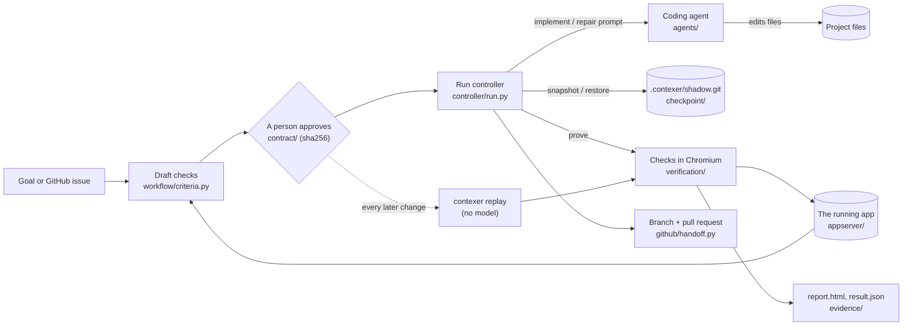
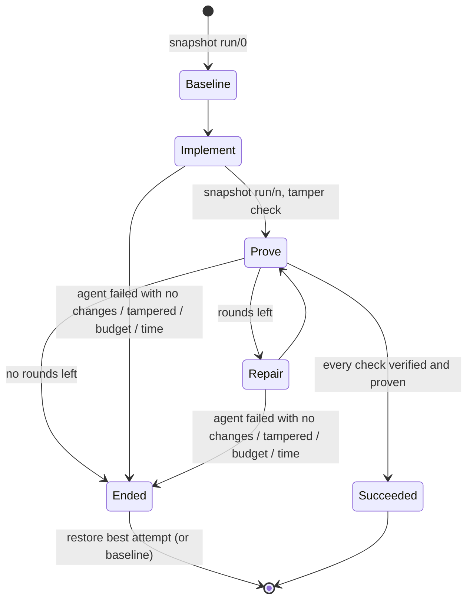
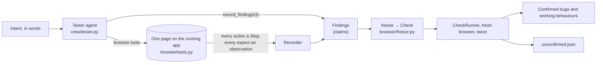
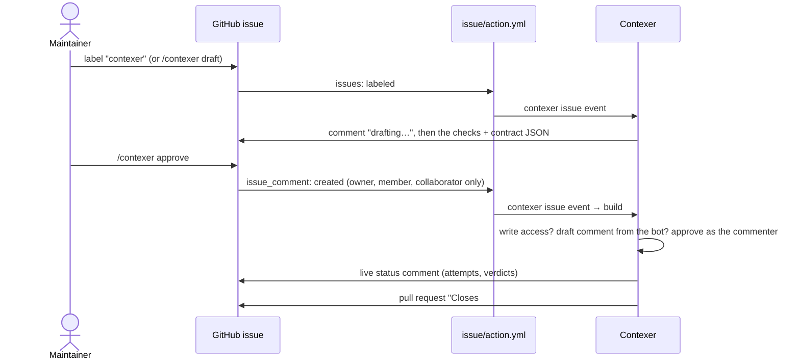

# Contexer architecture

This is the technical reference for how Contexer works, module by module: what
each part does, the data it reads and writes, the decisions it makes, and the
constants that govern them. It describes version 0.5.0 as it is in the code.
Product reasoning is in [product-plan.md](product/product-plan.md), the build history
in [roadmap.md](roadmap.md), and day-to-day use in [try-it.md](try-it.md).

Paths are relative to `contexer-agent/src/contexer/` unless they start with
`contexer-agent/` or the repository root.

## Contents

1. [Principles](#1-principles)
2. [System overview](#2-system-overview)
3. [Repository and package layout](#3-repository-and-package-layout)
4. [Data model](#4-data-model)
5. [The check language](#5-the-check-language)
6. [Proving checks in a browser](#6-proving-checks-in-a-browser)
7. [Starting the app](#7-starting-the-app)
8. [Drafting checks from a goal](#8-drafting-checks-from-a-goal)
9. [The run loop](#9-the-run-loop)
10. [Snapshots](#10-snapshots)
11. [Coding agent adapters](#11-coding-agent-adapters)
12. [Models and bring your own key](#12-models-and-bring-your-own-key)
13. [Evidence](#13-evidence)
14. [GitHub](#14-github)
15. [The command line](#15-the-command-line)
16. [Configuration reference](#16-configuration-reference)
17. [Security model](#17-security-model)
18. [Benchmark](#18-benchmark)
19. [CI, the actions and releases](#19-ci-the-actions-and-releases)
20. [The OpenCode client](#20-the-opencode-client)
21. [Tests](#21-tests)
22. [Extending Contexer](#22-extending-contexer)
23. [Known limits](#23-known-limits)

## 1. Principles

1. **Rent the agents, own the verdict.** Contexer writes the contract, the
   verdict, the repair controller and the evidence. Coding agents (Claude
   Code, Codex, OpenCode) and models are dependencies behind adapters.
2. **The agent's word never counts.** An agent turn's report is stored, never
   used as a pass. Changed files come from Contexer's own snapshots.
3. **Deterministic code owns control flow.** The agent is called for exactly
   two things, implementing and repairing, inside a loop Contexer controls.
4. **Replays need no model.** An approved contract runs with zero model calls.
5. **Fail safe.** Anything undecided blocks (`needs_action`); nothing reports
   a quiet pass.
6. **Measured before claimed.** Accuracy claims come from `contexer bench`.

## 2. System overview



A `contexer run "GOAL" --pr`, end to end:

1. **Checks before spending anything** (`cli/run_cli.py`): refuse a home
   folder or drive root (`checkpoint/shadow.py: unsafe_work_tree`); with
   `--pr`, check the git checkout (`github/handoff.py: plan_handoff`); load
   the project's `.env` and `contexer.toml`; choose the agent; with `--issue`,
   read the issue; check OpenRouter's free requests when a free model is in
   use (`check_free_quota`).
2. **Draft** (`_draft`): start the app, take its ARIA snapshot, have the model
   compile the goal into a contract, then try the draft once on the app as it
   is (`preview_draft`).
3. **Approve** (`_approve`): show the checklist and the preview, ask, and on
   yes store the approval with the contract's sha256.
4. **Run** (`execute_graph` → `GraphController.run`): snapshot, implement, prove,
   repair up to the limit, keep the best attempt, write the evidence.
5. **Hand off** (`hand_off`): branch, commit, push, pull request.
6. **Report** (`_render`): one aligned summary, exit code from the outcome.

## 3. Repository and package layout

```text
<repository>/
  contexer-agent/            the Python package (published to PyPI as contexer-agent)
    src/contexer/            the code (below)
    tests/                   pytest suite
    bench/fixtures/          seeded-bug benchmark apps
    docs/                    product plan, roadmap, landscape, this file, try-it guide
    pyproject.toml PYPI.md CHANGELOG.md LICENSE THIRD_PARTY_NOTICES.md .env.example
  action.yml                 the acceptance-gate GitHub Action (composite)
  issue/action.yml           the issue-agent GitHub Action (composite)
  .github/workflows/         ci.yml, acceptance-gate.yml, release.yml
  website/                   the landing page (Next.js 16, Tailwind 4, static)
  marketing/                 launch kit and the Remotion launch video
  .agents/skills/            agent skills used to build this repository (ui-skills etc.)
```

| Package | Responsibility |
| --- | --- |
| `cli/` | The commands. `term.py` is the shared terminal design; `run_cli`, `gate_cli` (verify, replay, contract), `issue_cli`, `setup_cli` (setup, models), `doctor_cli`, `demo_cli`, `init_cli`, `runs_cli` (runs, runs prune, restore), `bench_cli` |
| `contract/` | `Contract` model, canonical hash, approval, file store |
| `verification/` | The check language (`checks.py`), the Playwright runner (`runner.py`), the verifier (`verifier.py`), result models |
| `observer/` | Page observation: ARIA snapshot, password masking, Chromium status |
| `gate/` | `GateDecision`, `RunResult`, the decision rules (`decision.py`) and `VerificationSession` |
| `appserver/` | Start-plan detection, the dev server, `open_app`, `[app] reset`, Windows Job Objects |
| `agents/` | `CodingAgentAdapter` and the Claude Code, Codex, OpenCode and scripted adapters |
| `opencode/` | HTTP client and adapter for `opencode serve` |
| `checkpoint/` | Shadow-git snapshots and restores |
| `controller/` | What a run is made of: scoring, failure signatures, the tamper guard and the evidence (`shared.py`), the run's models, and the prompts for the coding agent. The loop itself is `graph/` |
| `graph/` | The run loop as a LangGraph graph that can wait for a person, stop and resume: state, nodes, routing, the compiled graph, `GraphController` |
| `evidence/` | Run directories, `report.html`, `result.json` |
| `github/` | Commit status and job summary, the REST client, the pull-request hand-off, the issue flow |
| `llm/` | Provider catalog, model discovery, provider clients, structured-output parsing, chat models with tools (`chat.py`) |
| `crew/` | Contexer's own agents: the loop (`base.py: run_agent`), transcripts, the Intent agent (`intent.py`), the Tester (`tester.py`), the Challenger (`challenger.py`), the Diagnoser (`diagnoser.py`) and Triage (`triage.py`); prompts in `prompts/` |
| `intent/` | The intent store: what each feature should do, in the project (`.contexer/intent/`) |
| `skills/` | The skills store: what Contexer learned about operating the app (`.contexer/skills/`) |
| `browser/` | A browser an agent operates: the tools (`tools.py`), the recording of what it did (`recorder.py`), and freezing findings into checks and replaying them (`freeze.py`) |
| `config/` | Environment settings, `contexer.toml`, per-user settings in `~/.contexer` |
| `workflow/` | Goal-to-checks compiler (`criteria.py`), repository inspector, static file server |
| `bench/` | The seeded-bug benchmark: the gate suite (`runner.py`), the tester suite (`tester.py`), the repair suite (`repair.py`) and the reviewer suite (`reviewer.py`) |
| `demo/` | The `contexer demo` todo app and its contract |
| `procutil.py` | Process trees that are always stopped together |

Runtime dependencies: `typer`, `rich`, `openai` (the OpenAI-compatible
client), `pydantic` 2, `python-dotenv`, `httpx`, `playwright` (≥1.49, for
`Locator.aria_snapshot`), and for the agents being built on top of 0.4 (see
[agentic/architecture.md](agentic/architecture.md)) `langchain-core`,
`langchain-openai`, `langchain-anthropic`, `langgraph` and
`langgraph-checkpoint-sqlite`. Python 3.11 or newer. The
drafting client for Anthropic is plain `httpx`; the `anthropic` package is
there only because `langchain-anthropic` needs it.

## 4. Data model

### Files in a project

```text
<project>/
  contexer.toml                     optional settings (§16)
  .env                              optional keys and [auth] secrets (never committed)
  .contexer/
    .gitignore                      commits contracts/, intent/ and skills/; ignores the rest
    contracts/<id>.json             contracts (commit these)
    intent/<feature>.md             what the feature should do: goal, behaviours, corrections, assumptions
    intent/<feature>.checks.json    its checks: drafts, and the ones a replay confirmed
    intent/index.md                 the list of features
    skills/<name>.md                what Contexer learned about operating the app (advice)
    runs/<run-id>/                  evidence for one verify or run (§13)
    shadow.git/                     private snapshot repository (§10)
```

### Contract (`contract/models.py`)

```json
{
  "version": 1,
  "id": "todo-basics",
  "goal": "Users can add, complete and delete tasks, and the remaining count stays correct",
  "summary": "...",
  "criteria": [
    {"id": "complete-decrements", "description": "Completing a task lowers the remaining count",
     "verification_method": "interactive_test",
     "check": {"steps": [...], "expect": [...]}}
  ],
  "source": "llm | rules | user",
  "created_at": "2026-10-15T10:00:00Z",
  "approval": {"by": "murtuza777", "at": "...", "sha256": "40740b37aeef..."}
}
```

- **Hash** (`content_hash`): SHA-256 of canonical JSON (`sort_keys`, compact
  separators, `ensure_ascii=False`) over `goal` and each criterion's `id`,
  `description`, `verification_method` and `check` (by alias, nulls
  excluded). `summary`, `source` and dates are not hashed.
- **Status**: `draft` (no approval), `approved` (hash matches), `modified`
  (approved, but the content changed since). A modified contract never runs
  as approved.
- **Ids**: `slugify` keeps up to 6 words without stop words (`"contract"` if
  none); `ContractStore.unique_id` appends `-2`, `-3`.
- **Approver**: `--by`, else `git config user.name`, else `USER`/`USERNAME`,
  else `unknown`. The issue flow records the approving GitHub login.

### Verdicts and outcomes

| Verdict (per check) | Rule (`verification/models.py`) |
| --- | --- |
| `verified` | The check passed |
| `unverified` | A step could not act (`blocked`) or a step failed: nothing was decided |
| `refuted` | The steps ran and an expectation was observed to fail |

Each verdict carries its method: `proven` (`method == "assertion"`, executed
in the browser), `LLM-judged` (`judgment`) or `heuristic` (keyword matching,
confidence capped at 0.6). Only proven verdicts gate, plus judged ones when
`[gate] judged = "block"`.

Gate outcome (`gate/decision.py`), most severe wins: `error` (the app or a
step of Contexer failed) > `fail` (a gating check refuted) > `needs_action`
(anything unverified, a draft or modified contract where approval is
required, or a contract with no gating results) > `pass`.

### Exit codes

| Code | Meaning |
| --- | --- |
| `0` | pass / run succeeded |
| `1` | fail: a check was refuted / run ended on failing checks |
| `2` | needs action: unverified checks, draft or modified contract, budget or time used up, tampering, not approved |
| `3` | error: the app or the agent could not run, a pull request could not be prepared, no free requests left, or Contexer itself failed (`internal_error`) |
| `130` | stopped with Ctrl+C |

## 5. The check language

Defined in `verification/checks.py`. A check is a list of steps then a list
of expectations (`expect` needs at least one), run in a fresh browser.

**Targets** (`Locator`): exactly one strategy of `role`, `text`, `label`,
`placeholder`, `test_id`, `css`. `name` only goes with `role`, and `role` must
be an ARIA role. Aliases: `selector`→`css`; `testid`, `testId`, `data-testid`
→`test_id`; roles `a`→`link`, `input`/`textarea`→`textbox`,
`select`/`dropdown`→`combobox`, `image`→`img`, `nav`→`navigation`, `h1`–`h6`
→`heading`. A `role`+`name` target also matches a role element whose visible
text contains the name; the first visible match is used (at most 20 scanned).

**Steps**: `click`, `fill`, `press`, `select`, `check`, `uncheck`, `hover`,
`wait`, `goto`. Target required for click, fill, select, check, uncheck,
hover; value required for fill, select, press, wait, goto. `wait` is whole
milliseconds up to 10,000.

**Expectations**: `visible`, `hidden`, `checked`, `unchecked`, `count`
(`min`/`max`), `text`, `value`, `attribute`, `css` (`property`), `url`,
`title`, `no_errors`. Comparators, ANDed: `equals` (exact after whitespace
normalisation), `contains` (case-insensitive), `matches` (regex), `changed`
(differs from the value read before the steps ran). `attribute "checked"` is
rewritten to `checked`/`unchecked`.

**Sign-in**: `login` unset follows the project (signed in when `[auth]`
exists), `false` runs signed out, `true` requires a signed-in session.

**Secrets**: `${NAME}` in step values (pattern `[A-Za-z_][A-Za-z0-9_]*`) is
expanded from the environment at run time; an unset name fails the check
before it navigates (`MissingSecretError`). Expanded values are redacted to
`••••••` (longest first, values of 3+ characters) in the failed step, the UI
snapshot, page and console errors and each outcome.

**Failure report** (`CheckResult.failure_report`): `[id] executable check
BLOCKED|FAILED`, what could not be performed, up to 20 lines of what the page
offered instead, expected/actual for each failed expectation, and the first 3
uncaught exceptions. This text goes to the person and to the repair prompt.

## 6. Proving checks in a browser

### CheckRunner (`verification/runner.py`)

| Setting | Default |
| --- | --- |
| headless | `True` |
| navigation timeout | 15 s |
| action timeout | 3 s |
| expectation timeout | 2 s (polled every 0.1 s) |
| settle after steps | 250 ms |
| traces | `off` (`on`, `on-failure`) |

- One Chromium per run; each check gets a new context (viewport 1280×800,
  HTTPS errors ignored), with the signed-in `storage_state` unless the check
  says `login: false`.
- `timeout_scale` multiplies the navigation, action and expectation timeouts
  (not the settle time).
- `before_each` (the `[app] reset`) runs before every check; a failure blocks
  that check as unverified, never refuted.
- Execution (`_exercise`): `goto` with `wait_until="load"`, read baselines for
  `changed` comparators, run the steps, settle, then evaluate expectations.
  A missing or hidden target makes the check `blocked` with an ARIA snapshot
  of what the page offered; a target that was there but did not respond is
  a refutation.
- Page errors (`pageerror`) and console errors (`console` of type `error`,
  ignoring `/favicon.ico`) are collected; `no_errors` is evaluated last so
  late asynchronous exceptions count.
- Evidence: a JPEG screenshot per check (quality 70); a trace only when
  `trace != "off"`, and never for a signed-in check unless `trace == "on"`,
  because a trace records the session cookie.

### Sign-in (`[auth]`)

`CheckRunner.sign_in` runs the `[auth]` steps once per verification and keeps
`context.storage_state()` (cookies and local storage) in memory only. On
failure it raises `SignInError` with what did not hold, the final URL, any
`role=alert` text and a `sign-in.jpg`, with every typed value redacted; the
verification ends as an error. `sessionStorage` is not carried over.

### Observation (`observer/playwright.py`)

Before drafting, Contexer loads the app (`domcontentloaded`, 15 s, then
500 ms), and records the status, title, text, up to 40 interactive elements,
h1–h3 headings, errors and a screenshot. `capture_ui_snapshot` takes
`body.aria_snapshot()` plus `data-testid` and placeholder extras (up to 60),
cut at 4,000 characters. Password input values in the snapshot are replaced
with `••••••` before the snapshot goes anywhere.

### Verifier and session

`verification/verifier.py`: criteria with a check run as assertions; without
one, a model judges if one is available, else keyword heuristics. A page that
failed to load or answered HTTP 400+ fails at once.

`gate/session.py: VerificationSession` ties it together per run: `observe`,
`compile` (grounded in the snapshot), `verify` (per contract, evidence in
`runs/<id>/checks/<contract>/`, reset before each check, and for dev servers
`timeout_scale = 2.5` with a 60 s first load, because pages compile on first
use), and `result`.

## 7. Starting the app

`appserver/app.py: open_app` is a context manager that yields a `RunningApp`
(`url`, `kind`, `repo_context`, `log_tail`, `command`, `server`):

1. `--url` → `external`: used as is.
2. A static site without `[app] start` → `static`: `workflow/app_server.py`,
   a threaded HTTP server on `127.0.0.1`, OS-assigned port,
   `Cache-Control: no-store`. A static site has an `index.html` and no
   `package.json`, `pyproject.toml`, `requirements.txt` or `manage.py`.
3. Otherwise → `dev`: a start plan and a `DevServer`.

Every start failure becomes `AppStartError` with the log tail; the server is
always stopped on exit.

### Start plan (`appserver/detect.py`)

- `[app] start` wins: `{port}` is replaced (configured or a free port), run
  through the shell (`cmd.exe /d /s /c` or `/bin/sh -c`), `PORT` set.
- Else `package.json`: the first of the `dev`, `start`, `serve`, `preview`
  scripts. A port already pinned in the script is used as is.
- Framework (from the script, then dependencies): Next.js (`-p N -H
  127.0.0.1`), Astro and Nuxt (`--port N --host 127.0.0.1`), Vite (`--port N
  --strictPort --host 127.0.0.1`), CRA and others (environment only). npm puts
  `--` before the flags. Environment: `PORT`, `BROWSER=none`,
  `HOST=127.0.0.1`, plus `[app] env`.
- Package manager: the `packageManager` field, else the lockfile (`pnpm`,
  `yarn`, `bun`), else npm. Install: `npm ci` with `package-lock.json`, `pnpm
  install --frozen-lockfile` with `pnpm-lock.yaml`, else `<manager> install`;
  only when `[app] install` is true.

### Dev server (`appserver/devserver.py`)

- Installs when `node_modules` is missing (or on request; 900 s limit), then
  spawns the start command as a process tree (§procutil) with `FORCE_COLOR=0`
  and `CI=1`.
- Output goes to `server.log` and a 400-line ring buffer (ANSI stripped).
- Ready when the port answers 200–399 or 400–403 (Playwright `webServer`
  semantics), polled every 0.5 s up to `ready_timeout` (120 s), on both
  `127.0.0.1` and `localhost`, also trying any port the log announces. An
  early exit raises with the log tail.
- The run loop restarts with a reinstall when an attempt (or a revert)
  changes `package.json` or a lockfile (`_DEPENDENCY_FILES`).

### `[app] reset` (`appserver/reset.py`)

A shell command run before every check (120 s limit), with `{url}` and
`{port}` filled in. Checks share the app's server, so data one check saves is
there for the next; the reset puts it back. A failing reset blocks its check.

### Process trees (`procutil.py`)

- **Windows**: the child starts `CREATE_SUSPENDED` (plus
  `CREATE_NEW_PROCESS_GROUP | CREATE_NO_WINDOW`), is assigned to a
  kill-on-close Job Object (`appserver/winjob.py`, `JOB_OBJECT_LIMIT_KILL_ON
  _JOB_CLOSE`), then resumed with `NtResumeProcess`. Starting suspended stops a
  launcher such as `opencode.cmd` from spawning children before it is in the
  job. Without a job, `taskkill /T /F` is the fallback.
- **POSIX**: a new session; the whole process group gets `SIGTERM`, then
  `SIGKILL` after the grace period.
- `ProcessTree.kill` is lock-protected, so Ctrl+C and a worker thread can both
  call it.
- `popen_args`: a `cmd.exe /d /s /c X` command is passed as one string so
  quoted paths survive `cmd.exe`'s own parsing.

## 8. Drafting checks from a goal

`workflow/criteria.py: GoalAnalyzer.analyze(goal, repo_context, ui_snapshot)`:

- **Prompt**: a QA-architect brief asking for 4–10 criteria, the goal, the
  project summary (`RepositoryInspector.format_summary`), the live ARIA
  snapshot with the rule that existing elements must be located exactly as
  listed (or, with no rendered UI, that every locator becomes part of the
  contract), a source excerpt used only to learn locators, and
  `CHECK_DSL_GUIDE`. The model must reply with JSON (`summary`,
  `acceptance_criteria`).
- **The guide's rules**: prefer role+name, then text, then label/placeholder,
  then test id, CSS last; one behaviour per check; exact values; verify by
  interacting; each check runs alone in a fresh browser; checks start signed
  in (`"login": false` for signed-out behaviour); server data is shared, so
  created items get unique names that include the criterion id; cover edge
  cases (repeat, toggle back, edit one of many, form rules), each with
  `no_errors`; omit `check` only for criteria a browser cannot decide.
- **Attempts**: at most 2, each capped at 180 s. The first asks for JSON mode,
  the second does not. The better attempt by executable coverage is kept,
  stopping once at least 50% of criteria are executable. A 429 or rate limit
  stops retrying. `last_error` keeps the reason, `drafted_by` the model that
  actually answered.
- **Fallback**: with no usable reply, simple rules produce a draft
  (`source = "rules"`): a runtime check, keyword criteria and visible-text
  checks for quoted text. `--yes` never approves such a draft, and the CLI
  shows it as a "Weak draft".
- **Parsing** (`llm/structured.py`): strip `<think>` blocks, try the first
  fenced block, then the whole text, then every `{` with `raw_decode`,
  preferring objects with the expected key. Invalid checks are dropped.
- **Runtime check**: an LLM draft always gets a `no_errors` criterion
  (`crit-runtime`) if it has none.

**Preview** (`cli/gate_cli.py: preview_draft`): the draft runs once on the app
as it is, and the person sees which checks already pass (they will guard that
behaviour), which fail (the change must make them pass, or the check is
wrong) and which cannot run yet. When every check already passes, the person
is warned the checks may not test anything new.

**Repository inspector** (`workflow/inspector.py`): frameworks from
`package.json` (Next.js, Vite, React, Vue, Svelte, Node) or Python files
(FastAPI, Flask, Django), entry points, up to 50 key files, and a source
excerpt of up to 8,000 characters (entry points first; `.html`, `.js`,
`.mjs`, `.jsx`, `.ts`, `.tsx`, `.vue`, `.svelte`).

## 9. The run loop

`graph/engine.py: GraphController.run(contract, others)`. The contract must be
approved; `others` are the other approved contracts, replayed as regression
checks unless `--no-replay`. There is one loop. Until 0.5.0 there were two:
the loop of 0.4 (`--engine classic`) was removed once the graph had fixed the
same 46 of 46 seeded bugs ([phase-3.md](agentic/phase-3.md)). `--engine graph`
is still accepted; any other name is refused with a message that says so.

This part describes what every run does, with or without a model. What a
model adds, and waiting, stopping and resuming, follow under
[The graph](#the-graph-graph).

| Setting (`RunSettings`) | Default | Source |
| --- | --- | --- |
| `max_repair_rounds` | 2 | `--rounds`, `[agent] max_repair_rounds` |
| `budget_usd` | none | `--budget`, `[agent] budget_usd` |
| `turn_timeout` | 900 s | `[agent] turn_timeout` |
| `wall_clock` | 3600 s | — |
| `judged_policy` | `advisory` | `[gate] judged` |



Per attempt *n*:

1. **Agent turn**: implement (attempt 1) or repair, with the remaining budget
   and `turn_timeout`. The session is resumed unless a fresh one is needed.
2. **Tamper guard** (`_ContractGuard`): the contract files are compared with
   the bytes saved at the start; any change is put back and the run ends
   `tampered`.
3. **Snapshot** `refs/contexer/<run>/<n>`; changed files are the diff against
   the previous state the agent started from.
4. **Agent failure**: a failed turn with no changes ends the run
   (`agent_error`, or `budget_exhausted` when the budget ran out).
5. **Prove**: start the app once (`open_app`), or restart with a reinstall if
   dependencies changed, or `ensure_running`. An app that does not start
   becomes an `error` attempt whose log goes into the repair prompt. Otherwise
   all checks run (target plus regression contracts) in
   `runs/<run>/attempt-<n>/`.
6. **Score** (`_score`): +1 per proven verified check of the target contract,
   −2 per proven refuted check of another contract (a regression costs double),
   −1,000,000 for an attempt where the app did not run.
7. **Keep the best**: a better-scoring usable attempt becomes the best; a
   worse one is reverted to the best (`shadow.restore`), reinstalling if the
   revert changes dependencies.
8. **Signatures** (`_signatures`): for each proven, not-verified check,
   SHA-1 (10 hex) of the verdict, the failed expectations with their actual
   values, the failed step and the first page error. If a signature survives
   a repair unchanged, or the attempt was reverted, the next repair starts a
   fresh agent session focused on that failure.
9. **Repair prompt** (`controller/prompts.py: repair_prompt`): the app-start
   error or reasons, a failure bundle per failing proven check (failed step,
   expected vs actual, up to 3 exceptions and 3 console errors, and when
   blocked up to 25 lines of what the page offered), the checks already
   passing (keep them passing), the last 25 server-log lines, a revert notice,
   and the repeated failures.

**Terminal states**: `succeeded`, `failed_checks`, `needs_human` (only
unverified checks, or the app did not start, after the last round),
`budget_exhausted`, `timed_out`, `tampered`, `agent_error`, `app_error`,
`cancelled`, `internal_error` (a fault in Contexer: the files are put back as
for a stopped run, and the traceback is kept in the run folder as `crash.txt`).

**End state**: a successful run leaves the last attempt. Otherwise the best
attempt is restored; with no usable attempt the baseline comes back. A
tampered run restores the best attempt or the baseline. The project is never
left worse than it was found.

**Ctrl+C** (`on_exit`, registered first on the `ExitStack` so it runs after
the app has stopped): the agent's process tree is killed (or the OpenCode
session aborted), the unfinished work is snapshotted as
`refs/contexer/<run>/stopped`, the best attempt or the baseline is restored,
the evidence is written with the outcome `cancelled`, and the command exits
130. `contexer restore <run> --stopped` brings the unfinished work back.

**Implement prompt** (`implement_prompt`): the checks, not the agent's
judgement, decide when the work is done; the goal; the contract "executed
verbatim"; the other approved goals that must keep working; the project
summary; and the rules: smallest complete change using the exact names the
checks reference; do not start a dev server; do not install Playwright or
browsers or write end-to-end tests; do not touch `.contexer/`; do not commit,
push or rewrite history; no uncaught exceptions; reply with a short summary.

### The graph (`graph/`)

The loop is a LangGraph graph with a checkpoint after every node. With no
model configured it applies the fixed rules above and writes the plain
prompts; `tests/test_controller.py` pins what those produce.

- **Before anything is spent.** With `[auth]` configured, the sign-in flow
  is tried once before the first coding turn and before checks are
  drafted. If it does not work the run ends `needs_human` with nothing
  built: a coding agent cannot repair the person's test account. The
  first run behind a sign-in on a real app paid for three turns before
  this existed.
- **One budget.** `Budget.max_total_usd` (`[agents] max_usd`, `--max-usd`)
  covers the coding agent and Contexer's agents together. The engine tells
  the budget what the coding agent has spent; each turn is told what is
  left; a run that runs out ends `budget_exhausted` on its best attempt.
  A provider that reports no price is priced from `[agents]
  input_usd_per_mtok` and `output_usd_per_mtok`, and the total is marked
  as an estimate. With neither, cost is unknown and only tokens are
  limited. A coding agent can overshoot within one turn: Claude Code
  checks its budget between its own steps, and one turn went from $2.42
  to $6.26 against a $5 limit.
- **A model per agent.** `[agents.<name>] model`, `provider` and
  `max_steps` for intent, tester, challenger, triage, diagnoser and
  reviewer. An agent that is not named uses the default model. A model
  that cannot be built is reported and the default is used.
- **The estimate** (`crew/estimate.py`) is printed before a run: the most
  coding-agent turns and model calls it can make, from the caps in code.
  It is a ceiling, not a prediction.

```text
intent → approve → coder_turn → guard_snapshot → ensure_app → test → score ─ pass ─► review ─► finalize
   ▲        │           ▲  ▲                                            │               │
   │        │           │  └──────────── one repair, when code saw something ───────────┘
   │        │           │                                               │
   │   correction       │                                            triage ── stop ──► finalize
   └────────┴───────────┼──── correction ◄──────────────────────────────┤
                        │                                            ask_user
                        └────────────── diagnose ◄──────────────────────┘
```

| Node | Does | Asks a model |
| --- | --- | --- |
| `intent` | Starts the app and reads what the page shows, then drafts checks from the goal, or redrafts them for a correction; saves the intent and an unapproved contract | The Intent agent, when a model is configured |
| `approve` | Waits for a person (`interrupt`) unless the contract is approved at the hash the state holds | No |
| `coder_turn` | One turn of the coding agent; before it, the wall-clock and budget limits | No |
| `guard_snapshot` | Restores the files that define done if the agent touched them (`tampered`), snapshots the work | No |
| `ensure_app` | Starts or refreshes the app | No |
| `test` | Replays every approved check in Chromium | No |
| `score` | Scores the attempt, reverts a worse one to the best, ends the run on a pass or when no round is left | No |
| `review` | Reads the diff of an attempt that passed: a scan, the project's own commands, the Reviewer. May ask for one repair; cannot fail the run | The Reviewer, when a model is configured |
| `triage` | Chooses the next move among the legal ones | Triage, when a model is configured; otherwise the 0.4 rules |
| `ask_user` | Waits for a person's answer to Triage's question | No |
| `diagnose` | Writes the repair prompt from the browser's evidence; adds the Diagnoser's brief as a marked lead | The Diagnoser, when a model is configured |
| `finalize` | Restores the best attempt, writes the evidence, settles the outcome | No |

- **State and context.** `state.py: LoopState` is plain data (ids, attempts,
  snapshot commits, the prompt, scores, decisions) and is all a later
  process needs. The browser, dev server, coding agent, snapshot repository
  and models are in `context.py: RunContext` and are built again on resume.
  Each attempt's `RunResult` is also written to
  `attempt-<n>/run-result.json`, because a resumed run needs the failures to
  write the next repair prompt.
- **Drafting looks at the app first.** Before the Intent agent is asked,
  the `intent` node starts the app, signs in when `[auth]` is configured,
  and passes it the roles, labels, placeholders and test ids of the page
  it lands on and of up to three pages the goal names by path
  (`/app/symptoms`), all marked as untrusted (`ui_snapshot`). Checks
  drafted without it name things the app does not have, and a coding agent
  told to make them pass renames the app to fit; a live run did exactly
  that. When nothing runs yet the checks are drafted from the goal alone.
  The page is read as it loads, so names that only exist after an action
  (the label a new task's checkbox gets) are still guessed.
- **Routing.** `routing.py` holds every edge as a pure function of the
  state. A state with a terminal outcome goes to `finalize` from every node;
  a move that is not one of the five goes to `finalize`.
- **Who may say "succeeded".** Only `score`, on a gate decision of `pass`.
  `finalize` does not trust the state: `settle()` keeps `succeeded` only when
  `decide()` run again on the last attempt's recorded verdicts returns
  `pass`, and otherwise ends the run as `failed_checks`.
- **Review** (`crew/reviewer.py`). After an attempt passes, and before
  `finalize`, the diff from the baseline is read. Three sources, kept
  apart:
  - `prescan(diff)`, code only: a secret on an added line (known key
    formats, a private key, a mixed-case value of 16 or more characters
    assigned to a name like `api_key`, `token` or `secret`; the note says
    where and never repeats the value), an environment file in the
    change, `.only` or `skip` added in a test file, a deleted test file,
    more assertions removed than added in a test file, and `console.log`,
    `debugger` or `breakpoint()` added outside tests.
  - `run_commands`, code only: the `test`, `lint`, `typecheck` and
    `type-check` scripts of the project's `package.json`, each once, with
    a time limit (180 s), `CI=1`, and an environment without any variable
    named like a credential. Nothing else is ever run. npm's placeholder
    test script is skipped, and when dependencies are declared but not
    installed the commands are not run. A command that fails is a note; one
    that times out proves nothing. Files a command wrote are put back to
    the snapshot that passed.
  - the Reviewer agent, when a model is configured: `read_file`, `grep`
    and `list_changed_files`, all read-only. Its notes must name a file
    the diff touches, are capped at 500 characters and 20 notes, and
    repeat nothing the scan found.

  A note from the first two is `backed`: code saw it. A note from the
  model is advice and is never `backed`. When there is a backed note of
  medium or high severity, and a repair round, budget and time are left,
  the review asks the coding agent for **one** more turn
  (`MAX_REVIEW_REPAIRS`), in the session that did the work, with only the
  backed notes in the prompt. If that turn passes, it is reviewed again
  and the run ends. If it breaks a check, or the agent does not complete
  it, the files go back to the attempt that passed, the run ends
  `succeeded` on that attempt, and the notes stay in the report. So a
  review can ask for more, and it cannot take a pass away: `finalize`
  still recomputes the gate's decision on the attempt that stands.
  `RunSettings.review` (`contexer run --no-review`) turns the node off.
  Limits: a failing command is not run on the baseline, so the note says
  it may have failed before the change; only npm scripts are known.
- **Triage** (`crew/triage.py`). `legal_moves()` is code: no repair when no
  round or budget is left; no same-session repair after a revert; a
  rollback only when an earlier attempt is still the best; a question only
  when a person is at the terminal and has not been asked yet in this run.
  The model sees only the legal moves and answers with one and a one-line
  reason. Anything else (a move that is not legal now, a word that is not a
  move, a model error, a spent budget) is replaced by `rule_move()`, the 0.4
  rules, and what the model answered is kept in `rejected` and shown in the
  report. Triage has no tools.
- **Corrections.** A correction is text from the person about what done
  means. It is taken at the approval prompt, at Triage's question, from
  `--resume RUN --correct TEXT`, and from the controller's `corrections`
  callable before each turn and after each failed attempt. It goes to the
  Intent agent with the current checks; if the contract's hash changes it is
  saved unapproved and `approve` waits again. Checks that did not change keep
  the exact criterion that was approved. After a change, the next prompt
  restates the whole job in a fresh session, and the files that are there
  stay the fallback with a score any attempt that runs will beat.
- **Stopping.** Ctrl+C, or leaving a prompt, stops the app, kills the
  agent's process tree, snapshots the unfinished work as `stopped`, restores
  the best attempt or the baseline, writes the evidence as `cancelled` and
  exits 130.
- **Resuming** (`GraphController.resume`, `contexer run --resume RUN`). The
  checkpoint is `checkpoint.sqlite` in the run folder, written with
  `durability="sync"`. Resume refuses a run with no checkpoint (one made
  before 0.5.0, or a verification), reports a finished run without running anything, and refuses when a
  file that defines done differs from the hash in the state: those files are
  not in the snapshots, so a change made while the run was down was approved
  by nobody. Otherwise the files as they are are kept as
  `refs/contexer/<run>/before-resume`, the work tree is reset to the snapshot
  the next node expects, and the graph continues; a pending question is
  asked again.
- **Not built.** The Tester does not explore inside the loop: `test` replays
  approved checks only.

## 10. Snapshots

`checkpoint/shadow.py: ShadowRepo` is a private git repository at
`.contexer/shadow.git` whose work tree is the project:

- It works in folders that are not git repositories and never touches the
  user's `.git`, branches, index or stash (`GIT_DIR`/`GIT_WORK_TREE` are set
  per command; `GIT_INDEX_FILE` removed).
- Config: `core.autocrlf=false`, `core.safecrlf=false` (byte-exact),
  `core.longpaths=true`, `gc.auto=0`. `info/exclude`: `/.contexer/`,
  `node_modules/`, `.next/`, `.nuxt/`, `.svelte-kit/`, `.turbo/`, `.vercel/`,
  `.cache/`, `dist/`, `coverage/`, `.venv/`, `venv/`, `__pycache__/`, `*.log`.
  The project's own `.gitignore` files apply too, so `.env` is never
  snapshotted or restored.
- `snapshot(ref)`: `add --all`, `write-tree`, `commit-tree` (no parent), and
  `update-ref refs/contexer/<ref>`.
- `restore(commit)`: index the current state first (so files created since
  are known), then `read-tree -u --reset`: created files are removed, ignored
  files are left alone.
- `changed_paths` (`diff --name-only --no-renames`), `diff` (stat and patch,
  cut at 200,000 characters), `resolve(ref)`.
- `unsafe_work_tree` refuses a drive root or the home folder.
- Every git call passes `-c core.hooksPath=<null device>`, `core.fsmonitor=false`,
  `commit.gpgSign=false`, and diffs use `--no-ext-diff --no-textconv`: the folder is
  inside the project, so the coding agent can write to it, and nothing planted there
  (a hook, a setting that names a program) is started.

Refs per run: `<run>/0` (baseline), `<run>/<n>` (attempts), `<run>/stopped`,
`<run>/undo` (before a `contexer restore`), `<run>/before-resume`.

### Pruning (`contexer runs prune`, `cli/runs_cli.py: prune`)

Nothing else removes run folders or snapshots, and `gc.auto` is 0, so both
grow until a person prunes.

- **What goes.** Direct children of `.contexer/runs` that are plain folders
  named like a run id (`YYYYMMDD-HHMMSS-xxxx`), sorted by name, newest first
  as `contexer runs` lists them; the first `--keep N` (default 20, 0 allowed)
  stay. A symlink or a Windows junction is never entered and is left where it
  is, also when it is named like a run; a `runs` folder or a `.contexer` that
  is itself a link is refused. Other folders and files are left and named.
  Nothing outside `runs/` and `shadow.git` is opened for writing.
- **Unfinished runs are kept.** A run older than the newest N stays when it
  has `stopped.ref`, when its `run.json` ends in `cancelled` or
  `internal_error`, or when it has a checkpoint and no `run.json` (killed):
  `run --resume` can continue it, and its unfinished work exists only in its
  `stopped` snapshot. The output names it. `--include-unfinished` removes
  these too.
- **Lock.** The run lock is taken before the list is made and held until the
  last removal. When a run holds it, nothing is removed and the command
  exits 2 with the holder's name. `--dry-run`, and a call with no terminal
  and no `--yes`, remove nothing and so take no lock.
- **Asking.** The list (folder size, number of snapshots, outcome) is
  printed, then a yes/no question with "no" as the default. `--yes` skips
  the question. With no terminal and no `--yes` nothing is removed and the
  exit code is 2.
- **Removing.** The folder first (`shutil.rmtree`, which removes a link
  inside a run as a link; read-only files are made writable and retried; on
  Windows the `\\?\` path form lifts the 260-character limit), then
  `ShadowRepo.drop_run`, which deletes `refs/contexer/<run>/*` for exactly
  that run. A folder that could not be removed keeps its snapshots, and the
  exit code is 1.
- **Collecting.** `ShadowRepo.collect` runs `git gc --prune=now` with the
  same no-hook settings as every other call. `gc.recentObjectsHook` names a
  program that git starts while pruning and that no command-line setting
  turns off; one found in the snapshot repository's own config is removed
  first, and if it is still set (in the person's global config) nothing is
  collected and the command says so. The space freed is the run folders plus
  the difference in the size of `shadow.git`. Objects the index holds (the
  files as they were at the last snapshot) are not freed.
- **Not covered.** `contexer verify` and `contexer replay` do not take the
  run lock, so `--keep 0` during one of them removes the folder it is
  writing to. Snapshots whose run folder was deleted by hand are not found
  and stay.

## 11. Coding agent adapters

Two directions. Below, Contexer starts an agent headless and drives it. The
other way round, an agent a person is already working in calls Contexer:
`contexer mcp` (`integrations/mcp_server.py`) is a Model Context Protocol
server on stdio, built on the official `mcp` SDK. Its tools are
`contexer_checks`, `contexer_verify`, `contexer_brief` and `contexer_status`,
each taking at most one optional string (`contract`, an id matched against
the project's contracts and never opened as a path). `contexer_verify` takes
the run lock, replays in a worker thread so the server keeps answering, and
returns the same expected-and-actual report a repair prompt carries. Nothing
in the module prints, because stdout carries the protocol. No tool writes
what defines done; `tests/test_mcp_server.py` drives the server with a real
client and holds that.

The server is something the agent may call. The stop hook is something it
cannot skip. `contexer init --agent claude-code|codex`
(`integrations/agent_setup.py`) adds one Stop hook to the agent's project
settings; the agent's harness then runs `contexer hook stop`
(`integrations/stop_hook.py`) each time the agent ends a turn. It takes the
run lock, replays the approved contracts with `integrations/replay.py` (the
code `contexer_verify` uses) and prints `{"decision": "block", "reason":
...}` while one fails. Its state is `.contexer/hook-state.json`: the
session, the blocks in a row (the stop goes through after `--max-blocks`,
three by default, with a message to the person), and a fingerprint of the
project's files (the snapshot repository's tree id) and approved contracts,
so nothing is replayed when nothing changed since a pass. It always exits
0, and an exception inside Contexer lets the stop through. OpenCode has no
hook that can refuse a stop, so nothing is written for it.

`init --agent` (`agent_setup.set_up`) does three things per agent, each in
the file that agent reads: the server (`.mcp.json`; a table appended to
`.codex/config.toml`, which is parsed to check and never rewritten; for
OpenCode a pointer to `opencode mcp add`, because where servers sit in its
config changed between versions), the hook, and the instructions (a skill
at `.claude/skills/contexer/SKILL.md`, or a block in `AGENTS.md` that
starts with a marker so it is added once).

`agents/base.py: CodingAgentAdapter.run_turn(workdir, prompt, *, session_id,
timeout, budget_usd, on_progress) -> AgentTurn` with `status`
(`completed`, `failed`, `timeout`, `budget_exceeded`, `cancelled`),
`session_id`, `summary`, `error`, `cost_usd`, `duration_seconds`,
`num_turns`, `tool_calls`, `files_touched`, `permission_denials`. The turn is
informational only. Process-based adapters track their running trees
(`_track`/`_untrack`); `stop()` kills them, and `close()` calls `stop()`.

| Adapter | How it runs |
| --- | --- |
| Claude Code (`claude_code.py`) | `claude -p --output-format stream-json --verbose --permission-mode acceptEdits` with an allowed-tools list (Read, Edit, MultiEdit, Write, Glob, Grep, LS, TodoWrite, package installs, `npx tsc`, `npm run build/lint`, `ls`, `git status/diff`) and denied tools (`Edit/MultiEdit/Write(.contexer/**)`, `git commit/push/reset/checkout`, `rm -rf`); `--max-budget-usd`, `--model`, `--resume <session>`. The prompt goes to stdin; NDJSON events are parsed for progress, cost and the final `result` |
| Codex (`codex_agent.py`) | `codex exec --json --skip-git-repo-check --sandbox workspace-write --config approval_policy="never" --config sandbox_workspace_write.network_access=true --cd <dir> [--model] -`, and `resume <thread_id> -` for repairs. Only `turn.completed` / `turn.failed` end a turn. Codex reports no cost, so `--budget` does not apply |
| OpenCode (`opencode_agent.py`) | Talks to `opencode serve` over HTTP (`OPENCODE_SERVER_URL`, default `http://127.0.0.1:4096`), starting it if `/global/health` does not answer (60 s). A session per run; tool calls are polled every 2 s for progress. The server is started with `OPENCODE_CONFIG_CONTENT` carrying `permission.edit` rules that deny `.contexer/**`, added to any config the user passes (checked live on OpenCode 1.4.3; a shell command can still write there, which the tamper guard catches). On a timeout or Ctrl+C the session is aborted. With `OPENROUTER_API_KEY` and no model chosen it uses `openrouter/nvidia/nemotron-3-ultra-550b-a55b:free` |
| Scripted (`scripted.py`) | Applies queued file writes per turn (`None` deletes). `--agent scripted --model turns.json` reads them from a JSON list; used by tests and to try a setup without a model |

Claude Code and Codex run in a worker thread; on cancellation the tree is
killed so the thread (and Python's executor shutdown) does not wait for the
turn. Agent processes get the user's environment minus a parent Claude
session's plumbing and minus every repository token (`GITHUB_TOKEN`,
`GH_TOKEN`, `CONTEXER_GITHUB_TOKEN`, `ACTIONS_RUNTIME_TOKEN`,
`ACTIONS_ID_TOKEN_REQUEST_*`), with `CI=1`.

Agent choice (`cli/run_cli.py: choose_agent`): `--agent`, then `[agent] name`
if set in `contexer.toml`, then `CONTEXER_AGENT` (from `contexer setup`),
then `claude-code`. The model: `--model`, then `[agent] model`, then
`CONTEXER_AGENT_MODEL` when it was saved for that agent.

## 12. Models and bring your own key

### Provider catalog (`llm/catalog.py`)

`ProviderSpec(id, label, key_env, keys_url, protocol, base_url,
default_model, opencode_id, native_agent, local, note)`:

| Id | Key variable | Base URL | Default model | Native agent |
| --- | --- | --- | --- | --- |
| `openrouter` | `OPENROUTER_API_KEY` | openrouter.ai/api/v1 | `nvidia/nemotron-3-ultra-550b-a55b:free` | — |
| `anthropic` | `ANTHROPIC_API_KEY` | api.anthropic.com/v1 (Anthropic protocol) | `claude-opus-5-5` | Claude Code |
| `openai` | `OPENAI_API_KEY` | api.openai.com/v1 | `gpt-5` | Codex |
| `azure` | `AZURE_OPENAI_API_KEY` | your own, from `AZURE_OPENAI_ENDPOINT` (Azure AI Foundry; the model is your deployment name) | — | — |
| `google` | `GEMINI_API_KEY` | generativelanguage.googleapis.com/v1beta/openai | — | — |
| `groq` | `GROQ_API_KEY` | api.groq.com/openai/v1 | — | — |
| `deepseek` | `DEEPSEEK_API_KEY` | api.deepseek.com | — | — |
| `mistral` | `MISTRAL_API_KEY` | api.mistral.ai/v1 | — | — |
| `togetherai` | `TOGETHER_API_KEY` | api.together.xyz/v1 | — | — |
| `xai` | `XAI_API_KEY` | api.x.ai/v1 | — | — |
| `fireworks-ai` | `FIREWORKS_API_KEY` | api.fireworks.ai/inference/v1 | — | — |
| `cerebras` | `CEREBRAS_API_KEY` | api.cerebras.ai/v1 | — | — |
| `nvidia` | `NVIDIA_API_KEY` | integrate.api.nvidia.com/v1 | — | — |
| `ollama` | `OLLAMA_API_KEY` | localhost:11434/v1 (local, no key needed) | — | — |
| `custom` | `CONTEXER_CUSTOM_API_KEY` | `--base-url` | — | — |

Providers without a native agent build through OpenCode as
`<opencode_id>/<model>`.

### Clients

- `llm/openrouter.py: OpenAICompatibleProvider` (the `openai` SDK) serves every
  OpenAI-protocol provider (`for_spec`). It reports the model that actually
  answered (`response.model`). Errors map to `LLMAuthenticationError` (401,
  bad key), `LLMRateLimitError` (429, quota, credits),
  `LLMModelUnavailableError` (404), `LLMNetworkError` and `LLMError`, with the
  key scrubbed from messages.
- `OpenRouterProvider`: when the model is the default, the request carries
  `extra_body={"models": [default, "openrouter/free"]}` so OpenRouter falls
  back to its free router; a model the user picked is used as given.
- `llm/anthropic.py`: plain `httpx` to `/v1/messages` (`anthropic-version:
  2023-06-01`, 16,000 max tokens, 300 s), no tool calling.

### Chat models with tools (`llm/chat.py`)

The drafting clients above cannot call tools. The agents use LangChain chat
models built from the same catalog:

- `resolve_model(provider, model, config)` gives the model, key and endpoint
  with the factory's rules (below), and refuses a provider with no key or no
  model instead of guessing.
- `chat_model(provider, model)`: `ChatAnthropic` for the Anthropic protocol;
  for every other provider one class, `ChatOpenAI`, on Chat Completions with
  the provider's base URL. OpenAI and Azure get `max_completion_tokens`
  (Azure's models refuse the old name); every other provider gets
  `max_tokens`. An Azure endpoint is recognised by its host even under the
  `custom` provider, and is accepted however it was pasted: the resource
  URL or the full URL of one API (`.../openai/v1/responses`) both become
  `.../openai/v1`. OpenRouter keeps its
  attribution headers and, for the default model, its free fallback list.
  Building a model makes no network call, and LangChain is imported only then.
- `supports_tools(provider, model)`: True, False or None (the provider does
  not say), read from the provider's model list; never a model request.
  `contexer doctor` shows it as "Tool calling".
- A model that cannot call tools gives a `ToolCallingError` that names it:
  from `require_tools` when the provider's list says so, from
  `tool_calling_error` when the API refuses the request, and from
  `check_tool_calling` (one real tool call and its result, used by the live
  test) when the model answers without calling the tool.

### The agent loop (`crew/base.py`)

`run_agent(spec, model, tools, user_input, *, run_dir) -> AgentResult` runs
one agent. `AgentSpec` holds its name, system prompt, output schema (a
pydantic model) and limits: `max_steps` (30), `timeout` (600 s) and
`max_output_tokens` (4,096).

- The model gets the agent's tools plus `submit`, whose arguments are the
  output schema. Calling `submit` with a valid answer ends the run. An answer
  written as JSON text is accepted too.
- An answer that does not fit the schema goes back to the model with what was
  wrong, at most twice (`MAX_CORRECTIONS`).
- Tool calls in one reply run in order. A tool that raises, an unknown tool
  and bad arguments all become an error result the model can read; none ends
  the run. Results longer than 20,000 characters are cut.
- `AgentResult.status`: `ok`, `step_limit`, `timeout`, `invalid_output`,
  `model_error`. It also carries the steps (model calls), tool calls, tokens
  in and out, the duration, and the cost when the provider reports one
  (OpenRouter's `usage.cost`); otherwise the cost is `None`, never a guess.
- The output is the agent's opinion. Nothing in `crew/` can mark a result as
  proven.

**Transcript** (`crew/transcript.py`): each run appends to
`runs/<run-id>/agents/<name>.jsonl`. A `start` line (model, input, tools,
limits), then one `model` line per model call (step, seconds, tokens in and
out, cost, text, tool calls, or the error) and one `tool` line per tool call
(name, arguments, status, result, seconds), then an `end` line (status,
totals, the output). `Masker` replaces the secrets the caller names, every
provider key and token in the environment, and anything shaped like an API
key, using `verification/checks.py: redact`. Tool results are masked before
they go back to the model, so a password shown on a page reaches neither the
prompt nor the file.

**Tracing**: with `LANGFUSE_PUBLIC_KEY` and `LANGFUSE_SECRET_KEY` set and the
`tracing` extra installed, `tracing_callbacks()` attaches Langfuse's LangChain
handler to every model call. With them unset, `langfuse` is not imported.

### The Tester and `contexer test` (`browser/`, `crew/tester.py`, `cli/test_cli.py`)



- **Browser tools.** `BrowserSession` holds one Chromium page on the app,
  with the project's signed-in state. The tools are `snapshot`, the step
  verbs (`click`, `fill`, `press`, `select`, `check`, `uncheck`, `hover`,
  `goto`), `expect`, `read_errors` (uncaught exceptions, console errors,
  requests that failed or answered 400+), `screenshot` and `reset` (a fresh
  context, the `[app] reset` command if there is one, optionally signed
  out). Targets are validated by `Locator`; actions run through
  `CheckRunner._perform` and expectations through `CheckRunner._evaluate`,
  the code a replay uses. A tool never raises: a problem is text starting
  with `Error:`, with the page's snapshot when a target matched nothing.
  Only actions that happened are recorded.
- **Recorder.** Steps since the page was last fresh, and an `Observation`
  per `expect` (id `e1`, `e2`..., the steps so far, the expectation, pass or
  fail, what the page showed, whether it was signed out).
- **Tester.** `run_tester(intent, model, browser, ...)` runs in `run_agent`
  with the browser tools and `record_finding(kind, title, observation, ...)`.
  The model gets the intent, the current snapshot and the descriptions of
  the approved checks. A finding is refused when the observation does not
  exist, when a `bug` points at a pass or a `works` at a fail, or when the
  observation was already reported. Default 40 steps, 900 s. Whatever ends
  the run, the findings recorded so far are returned.
- **Freeze and replay.** `freeze(finding)` is the recorded steps plus the one
  expectation. `replay_findings` runs every check `DEFAULT_REPEATS` (2)
  times with the project's sign-in and reset. Confirmed: a `bug` whose check
  is refuted every time, a `works` whose check passes every time.
  Unconfirmed, with the reason: the other answer, a step that could not act,
  or replays that disagreed. `draft_contract` turns the confirmed checks into
  an unapproved contract; the checks of confirmed bugs fail today and are
  the acceptance checks for the fix.
- **`contexer test`.** Builds the model (`--provider`/`--model`, else the
  drafting model's choice; a model its provider lists without tools is
  refused), starts the app, signs in, runs the Tester, replays, and writes
  `result.json`, `report.html`, `agents/<agent>.jsonl`, `replay/` screenshots,
  `draft-contract.json`, `fix-prompt.md` and `unconfirmed.json` in the run folder. `--save`
  also stores the draft among the project's contracts. Outcomes and exit
  codes: `no_bugs` 0, `bugs` 1, `could_not_test` 2 (no model, or the model
  failed before any bug was confirmed), `error` 3 (the app did not start,
  sign-in failed, Chromium missing), 130 after Ctrl+C.
- **When the app said why.** A failed `expect` records the page's visible
  `role=alert` messages. A bug whose observation has such a message is not
  asserted as a bug: the app most likely refused something on purpose and
  said so. This is decided by code, with no model; the finding is listed
  with the message (`explained` in `result.json`) for the person to judge,
  and it is not challenged, diagnosed or saved as a check. It was added
  after two model-judgement layers (the Tester seeing the message, then the
  Challenger) each let the same false alarm through on a held-out app.
- **Challenger** (`crew/challenger.py`). Replay proves that a finding's steps
  end with its expectation not holding; it cannot tell whose fault that is.
  After replay, one model call reviews the confirmed bugs against the
  intent, the steps and what the app was showing (a failed `expect` records
  the page's visible `role=alert` messages). A finding is set aside only
  with a `tester_error` verdict and a reason; a verdict on a finding that
  does not exist, any other verdict, a model error or a spent budget leave
  every finding standing. Set-aside findings are printed and stored in
  `result.json` (`set_aside`), not saved as checks, and not diagnosed.
- **Intent** (`intent/store.py`, `crew/intent.py`). A feature's intent is a
  Markdown file a person can edit: the goal, the behaviours derived from it,
  dated corrections, and assumptions taken without asking. `as_text()` is
  what the agents read; corrections are marked as overriding the rest.
  `run_intent` gives the Intent agent the goal, the stored intent, the
  project summary and the page, and takes back behaviours, draft checks and
  questions. Code keeps these rules: a correction is written into the intent
  before the model is called; a question without two different readings is
  dropped and at most 3 are kept; with `assume` the first reading is
  recorded as an assumption instead of asked; each draft check is validated
  by `workflow/criteria.py: _parse_check`, sent back once when invalid, then
  dropped and reported; after a correction only the checks the agent names
  are replaced or removed, and a check a replay confirmed cannot be removed.
  The tamper guard (`controller/run.py`) covers `intent/` as well as
  `contracts/`.
- **Diagnoser** (`crew/diagnoser.py`). `fix_prompt(failures, brief)` writes
  the prompt a person pastes into a coding agent. Everything under "What is
  wrong" (the steps, each failed expectation with what the browser saw, the
  uncaught exceptions) is inserted by code from the `CheckResult`, word for
  word, and is the same text with or without a brief. `diagnose` runs the
  agent with `read_file` and `grep`, both read-only, confined to the project
  and closed to `.contexer/`, `.git/`, dependencies, `.aws/`, `.ssh/` and files that hold
  credentials by name (`.env`, `*.env`, `.npmrc`, `.netrc`, `*.pem`, `*.key`, `id_rsa`...).
  `grep` resolves every file first, so a link or a junction cannot lead out of the project
  or into a closed folder. Its
  `RepairBrief` adds the likely cause (labelled a hypothesis), the files,
  the instruction and what must keep working. With no brief the prompt is
  still complete.
- **Skills** (`skills/store.py`). When it submits, the Tester may propose up
  to 3 skills about operating the app. `SkillStore.save` refuses one that
  contains a configured secret or anything shaped like an API key. Before a
  run, the skills whose name or description shares a meaningful word with
  the intent (at most 5) are added to the Tester's task as advice.
- **One run of `contexer test`.** Intent agent (questions asked once when a
  person is at the terminal and `--yes` is not given), Tester, replay,
  then for confirmed bugs the Diagnoser and `fix-prompt.md`. The intent and
  the confirmed checks are saved in `.contexer/intent/`. `--again` replays
  the saved confirmed checks with no model: if any fails it prints which,
  rebuilds the prompt from the facts and stops without building a model; if
  all pass it goes on to explore. `--correct "..."` records a correction
  through the Intent agent and tests again. `--copy` puts the prompt on the
  clipboard.
- **Ctrl+C.** asyncio cancels Playwright's own tasks with ours, and a close
  then waits for an answer that never comes. `BrowserSession.close` bounds
  the wait (5 s, 1 s when interrupted) and leaves the close behind; the
  driver exits with the event loop and takes Chromium with it. The app's
  server is stopped by `open_app`.

### Guardrails

The rule is to assume the model is compromised: a page, a file or a saved
skill can carry text written to steer it. Each guardrail is a property of
the code and has a test in which a scripted model does what an attacker
wants (`tests/test_guardrails.py`). The plan is in
[agentic/hardening.md](agentic/hardening.md).

| A steered agent tries to | What stops it |
| --- | --- |
| Report a bug that is not there | `browser/freeze.py`: a finding that does not reproduce on replay is never shown. `crew/challenger.py`: a second look at each confirmed bug can set it aside as the tester's doing (the steps skipped a condition the intent states, or the app said why it refused); it can only remove, needs a reason, and what it removes is listed with that reason |
| Spend without limit | `crew/budget.py`: one `Budget` per run, shared by every agent, checked before each model call (`[limits] tokens`, `--max-tokens`, default 1,500,000). At most 25 tool calls run from one reply, and the same call four times in a row is refused |
| A replayed check leaves the app | `verification/runner.py`: a `goto` to another site is refused, and so is an address with a backslash, a control character, a user name or `${NAME}` in it (a browser and Python do not read every address alike). A check stops at the first step after the page has left the app's origin; the `[auth]` sign-in may pass through another site. `[auth]` cannot name a repository token, a model key or a tracing key |
| Leave the app and act elsewhere | `browser/tools.py`: `goto` to another origin is refused; an action that leaves the origin is undone, not recorded, and marks the recording unreliable; pop-ups are closed |
| Click and type on a live site | `contexer test --url` to a host that is not this machine or a private network needs `--allow-remote` |
| Change the project | No agent has a write tool (the table below, enforced by a test); a full run leaves every file outside `.contexer/` unchanged |
| Read secrets or Contexer's files | `read_file` and `grep` refuse paths outside the project, `.contexer/`, `.git/`, dependencies and `.env` files; secrets are masked in tool results and transcripts |
| Steer the coding agent through the fix prompt | `validated_brief`: files must exist inside the project, the cause and instruction are capped, and the prompt tells the coding agent what a model-written section may not ask for |
| Plant instructions for later runs | Skills are capped (160 and 800 characters, 30 in the store) and `--no-skills` ignores them; the Intent agent cannot change the goal, writes at most 25 behaviours, and what it adds or rewrites is printed |
| Redefine "done" or the command Contexer runs | The tamper guard covers `contracts/`, `intent/` and `contexer.toml`. A resumed run compares those files with the hashes in its checkpoint and refuses to continue if one changed while it was stopped |
| Declare the work done | `graph/routing.py: settle`: a run ends `succeeded` only when the gate's decision, computed again from the replayed checks, is `pass`. Triage's moves do not include one that passes a run, and a move outside the legal list is replaced by the rules |

Text from the app (page snapshots, project summaries, diffs, server logs,
failure reports, command output, saved skills) goes into every prompt inside
`<untrusted source="...">`, and text that imitates the closing marker is
neutralised (`crew/untrusted.py`). That is the soft layer: it makes steering
less likely, and nothing depends on it.

A goal a person typed to Contexer is theirs. A goal taken from a GitHub
issue is not: anyone who can open an issue wrote it. A contract drafted
from an issue records that in `origin` ("GitHub issue #7"; not part of the
approved hash), and `quoted_goal()` then puts the goal into every prompt
(the coding agent's, the Intent agent's, the Diagnoser's, the Reviewer's)
inside `<untrusted source="issue">` under a fixed preamble that says who
wrote it and that anything in it which is not about the app's behaviour is
not the goal. `contexer issue build` sets `origin` itself, so editing the
JSON in the draft comment cannot remove it. The approval by someone with
write access is still what makes the checks count.

### Tool audit

| Agent | Tools | Can it write? |
| --- | --- | --- |
| Intent | none (only `submit`) | No. Code writes the intent file from its answer |
| Tester | `snapshot`, `click`, `fill`, `press`, `select`, `check`, `uncheck`, `hover`, `goto`, `read_errors`, `screenshot`, `expect`, `reset`, `record_finding` | Only the app under test, through its own UI, on its own origin. `screenshot` writes a JPEG into the run folder |
| Challenger | none (only `submit`) | No. It can only set a confirmed bug aside, with a reason |
| Triage | none (only `submit`) | No. It chooses one of the moves code lists as legal; no move ends a run as succeeded |
| Diagnoser | `read_file`, `grep` | No. Both are read-only and confined |
| Reviewer | `read_file`, `grep`, `list_changed_files` | No. All three are read-only and confined. The project's `test`, `lint` and `typecheck` scripts are run by code before the agent starts, not by the agent; files they write are put back |

Only the external coding agent edits the project. A new tool for an agent
has to be added to this table and to `test_each_agent_has_exactly_the_tools_in_the_audit_table`.

### Choosing the drafting model (`llm/factory.py`)

1. `[compiler] provider` / `model` in `contexer.toml`.
2. `CONTEXER_LLM_PROVIDER` (what `contexer setup` saved).
3. The first of `anthropic`, `openai`, `openrouter` with a key, then any other
   keyed catalog provider with a default model, whose configuration is valid.

The model for a provider: an explicit argument, then `CONTEXER_LLM_MODEL` only
if that provider is the one named in `CONTEXER_LLM_PROVIDER` (the "paired"
rule: a provider never inherits another's model or base URL), then the
provider's own variable (`OPENROUTER_MODEL`, `OPENAI_MODEL`,
`ANTHROPIC_MODEL`), then the catalog default.

### Discovery (`llm/discovery.py`)

- `list_models`: `GET {base}/models`, newest first; free when both prices are
  zero or the id ends in `:free`; tool support from `supported_parameters`.
- `check_key`: OpenRouter's model list is public, so its key is checked with
  `GET /key`; other providers by listing models. 401/403 means "rejected the
  key", never echoing it.
- `try_model`: one tiny request ("Reply with the single word: ok"); `contexer
  setup` saves nothing unless it answers.
- `openrouter_free_quota`: `GET /key` → `free_model_daily_requests`
  (`used`, `limit`, `remaining`). `contexer run` stops when none are left and
  asks when fewer than 25 (`LOW_FREE_REQUESTS`) remain; `doctor` shows it.

### User settings (`config/user.py`)

- `~/.contexer/` (or `CONTEXER_HOME`): `config.toml` (`[model]` provider,
  model, base URL; `[agent]` name, model) and `credentials.toml` (`[keys]`,
  mode 0600 on POSIX).
- Precedence: exported variables, then the project's `.env`, then what
  `contexer setup` saved, then `contexer.toml` for the settings it covers.
  `apply_user_settings` fills only unset variables and records what it set,
  so a project's `.env` loaded later (`--dir` elsewhere) can replace exactly
  those values.
- `contexer setup` flow: provider → key (hidden input, or reuse an existing
  one) → `check_key` → model from the provider's list (OpenRouter suggests
  free models with tools) → `try_model` → coding agent (the provider's native
  agent if installed, else OpenCode) → save → check Chromium and offer to
  install it.

## 13. Evidence

`evidence/rundir.py`: run ids are `%Y%m%d-%H%M%S-<4 hex>`; everything for a
run is in `.contexer/runs/<run-id>/`:

```text
report.html            self-contained report (inline CSS, screenshots as data URIs)
result.json            the RunResult, without the page's HTML, text and base64 screenshot
run.json               contexer run only: the whole RunOutcome (attempts, agent turns, diff, cost)
server.log             the dev server's output
checks/<contract>/     per-check screenshots (and traces when kept)
attempt-<n>/           contexer run: the same, per attempt (plus run-result.json)
checkpoint.sqlite      contexer run: the state after every node; what --resume reads
agents/<name>.jsonl    one transcript per Contexer agent (crew/), secrets masked
replay/                contexer test: a screenshot per replayed finding
screens/               contexer test: screenshots the Tester took
draft-contract.json    contexer test: the confirmed checks, not approved
fix-prompt.md          contexer test: the prompt to paste into a coding agent, when a bug was confirmed
unconfirmed.json       contexer test: findings that did not reproduce, with the reason
sign-in.jpg            when sign-in failed
observation_*.png      the page as observed before drafting
```

`report.html` (`evidence/report.py`): a header with the verdict and counts
(verified, refuted, unverified, advisory), app, start, duration, mode and run
id; up to 30 reasons; for `contexer run` the attempts table; a card per
contract, failures first, with each check's mark, `proven` or `LLM-judged`
tag, steps, expected vs actual, up to 5 exceptions, what the page offered
instead, the screenshot and the trace path; the loaded page; and the last 80
server-log lines.

## 14. GitHub

### Commit status and job summary (`github/status.py`)

`contexer replay --github` posts `contexer/acceptance` on the commit (the pull
request's head SHA from `GITHUB_EVENT_PATH`, else `GITHUB_SHA`, else `git
rev-parse HEAD`): `pass`→`success`, `fail` and `needs_action`→`failure`
(statuses have no neutral, and a required check must not pass quietly),
`error`→`error`, with a description of at most 140 characters and a link to
the workflow run. In Actions it also writes a per-check markdown table to
`$GITHUB_STEP_SUMMARY`.

### REST client and token (`github/api.py`)

`GitHubClient` (httpx, API version 2022-11-28): issues, issue comments (paged,
100 per page), comment edits, collaborator permission, and pull requests. The
token comes from `CONTEXER_GITHUB_TOKEN` (a personal or app token, so pull
requests Contexer opens in Actions start other workflows), `GITHUB_TOKEN`,
`GH_TOKEN`, then `gh auth token`. The repository comes from
`GITHUB_REPOSITORY`, else the `origin` remote URL.

### Pull-request hand-off (`github/handoff.py`)

`plan_handoff(project)`, before anything is spent: a git repository with a
commit, on a branch (not detached), with no uncommitted changes to tracked
files; the remote (`origin`, else the first) and its GitHub repository.

`hand_off(plan, outcome, contract, issue)` after the run, unless it was
tampered or cancelled, and only when files changed:

1. Branch `contexer/<contract-id>` (`-2`, `-3` if taken locally or on the
   remote), switched to with the working changes.
2. `git add --all -- <changed files> <contract file>`: exactly the files the
   run changed (from the shadow diff) plus the approved contract, unless the
   project's `.gitignore` ignores it. Monorepo projects use paths from the
   repository root. The user's other untracked files stay out.
3. Commit with the goal as subject (cut at a word boundary, 72 characters) and
   the proof in the body; a fallback identity `Contexer
   <contexer@users.noreply.github.com>` only when git has none. A failing
   pre-commit hook leaves the changes staged and says so.
4. Push with `--set-upstream` (`GIT_TERMINAL_PROMPT=0`); in Actions the token
   is passed as an `http.<server>/.extraheader`, so nothing is stored in
   `.git/config`.
5. Open the pull request: ready for review when the run succeeded, a draft
   otherwise, and also a draft when the run succeeded but the review holds
   a high-severity note of any kind (from the scan or from the model); where drafts are not supported, a normal one titled
   `[Draft] ...`; an existing one for the branch is reused. Without a token,
   the result is the compare link.

The description (`pull_request_body`): the outcome, the goal, the checklist
with each verdict and evidence, the regression replay count, the agent,
attempts, repair rounds, cost and duration, the contract and its approval
hash, where the evidence is (the workflow run's artifact in Actions), and
`Closes #N` for issue runs. You are left on the new branch.

It also carries: **What was understood** (the
intent's behaviours, corrections and assumptions, when the run wrote an
intent), **Attempts** (each attempt's result and what was decided after
it, by a model or by the rules, when there was more than one), and
**Review** (each note with its severity, where, and whether a program or
a model found it). Checks found by the Tester are not there: the Tester
does not run inside the loop yet.

### Issue flow (`github/issues.py`, `cli/issue_cli.py`, `issue/action.yml`)



- `command_for(event)`: `issues: labeled` with the label → draft;
  `issue_comment: created` starting with `/contexer draft` or
  `/contexer answer <text>` → draft,
  `/contexer approve` or `/contexer build` → build; comments on pull requests
  and anything else → ignore. `contexer issue event --plan` prints it (and
  writes `command=` to `GITHUB_OUTPUT`) so the action installs the coding
  agent only for builds.
- **Draft comment**: `<!-- contexer:draft id=<id> sha256=<hash> -->`, the
  checks with how each fares on the app today, and the contract as JSON inside
  `<details>`. A maintainer may edit the JSON; the build notices
  (`edited since drafting`).
- **Drafting with the Intent agent** (when a model is configured): the comment also shows what the agent
  understood (behaviours, assumptions) and its questions, each with the
  reading the checks take and the other one. `/contexer answer <text>`
  drafts again; every answer on the issue from someone with write access
  is written into the intent as a correction before the model is called,
  and answers from anyone else are ignored. Nothing is kept between
  workflow runs: the issue and its comments are the state. With no model,
  the checks are drafted the 0.4 way.
- **Build**: the contract from the comment is approved in the approver's name
  and the graph starts at its approval point, which passes; the checks are
  not drafted a second time, because a second draft could differ from what
  was approved. Triage does not stop to ask (nobody is at a terminal).
  The approver must have `admin`, `maintain` or `write` access
  (checked through the API); only a comment by a `Bot` user counts as the
  draft, so a person's imitation is ignored; the contract is approved in the
  approver's name; `check_free_quota` warns; the run is followed by one
  status comment (`<!-- contexer:status -->`), edited on each phase and
  verdict (at most every 5 s, verdicts immediately); the hand-off closes the
  issue.

## 15. The command line

Entry point `contexer = "contexer.cli:app"`; `python -m contexer` works too.
The root callback loads the environment (exported variables, the nearest
`.env` with `override=False`, then saved settings); with no command it prints
the help.

| Group (`contexer --help`) | Commands |
| --- | --- |
| Get started | `setup`, `demo`, `doctor`, `init` |
| Build and prove | `test`, `run`, `verify`, `contract` (`draft`, `list`, `show`, `approve`), `runs` (`prune`), `restore`, `mcp` |
| CI and GitHub | `replay`, `issue` (`draft`, `build`, `event`) |
| More | `models`, `bench` |

### Terminal design (`cli/term.py`)

- No boxes: output reads the same in a terminal, a CI log and an issue.
- Colour carries meaning only (`OUTCOME_STYLE`, `TERMINAL_STYLE`): green
  proven, red refuted or broken, yellow needs a person; headings bold,
  secondary text dim.
- Marks `✓ ✗ ? ! ›` with ASCII stand-ins when the console encoding cannot
  show them (`mark`).
- `header` ("contexer run · subject"), `section`, `fields` (aligned key–value
  rows with a shared 12-character key column), `bullets` (hanging indent),
  `note`, `path` (relative to the current folder), `duration`.
- `Activity`: a transient live line (`⠋ Agent working · 0:42 · 7 tool
  calls`) drawn by Rich `Live` at 8 refreshes a second, with the elapsed time
  computed at each refresh; nothing is drawn when the output is not a
  terminal.

**The run view** (`cli/runview.py`). A run is drawn from its
events (`graph/context.py: RunEvent`: the words the log always had, plus
the values a view needs). Two things come from the same events:

- *Lines that stay.* `› Attempt 1 · implementing with claude-code`, then
  `1 file changed · 23s · $0.65`, then the verdict (`✗ 5 of 7 checks proven
  · 2 failed`) with each check that did not hold and what the browser saw
  under it, with a hanging indent. Triage's decision, a revert and the
  review are one line each. They are printed once, so a terminal, a CI
  log and a pasted issue show the same thing. The coding agent's tool
  calls are not printed unless `--verbose`.
- *A block redrawn in place*, in a terminal only: the attempt, every check
  with its state (the ones that failed first, with the short reason, at
  most 12 lines), a status line (`Agent working · 0:41 · 2 tool calls ·
  Edit src/app.js`), and a footer with the time and the money so far. It
  is taken away for a question to the person and at the end.

The summary at the end of a graph run does not repeat the attempts.

`contexer run --json` prints the events instead, one JSON object per line
and nothing else: `run-start`, `checks`, `attempt-start`, `agent`,
`agent-done`, `phase`, `verdict`, `strategy`, `review`, `revert`, `app`,
and a last `end` with `terminal`, `reason`, `exit_code`, `attempts`,
`cost_usd`, `report`, `pull_request` and `draft`. It needs `--yes`, since
it cannot stop to ask.

`contexer doctor` checks Python, Chromium (launching it), git, Node, saved
settings, the drafting model, coding agents, OpenRouter's free requests, the
GitHub token, how the project starts, its contracts and its sign-in secrets,
and prints the fix under each problem.

## 16. Configuration reference

### `contexer.toml`

| Key | Default | Meaning |
| --- | --- | --- |
| `[app] start` | from `package.json` | Start command; `{port}` is replaced |
| `[app] port` | a free port | Fixed port |
| `[app] ready_path` | `/` | Path probed for readiness |
| `[app] ready_timeout` | 120 | Seconds to wait for readiness |
| `[app] install` | `true` | Install dependencies from the lockfile when missing or changed |
| `[app] env` | `{}` | Extra environment for the app |
| `[app] reset` | none | Command run before every check; `{url}`, `{port}` |
| `[auth] url` | `/` | Where sign-in starts |
| `[auth] steps`, `expect` | — | Sign-in steps and proof, in the check language |
| `[compiler] provider`, `model` | from setup / keys | Drafting model; any catalog id |
| `[gate] judged` | `advisory` | `block` makes LLM-judged refutations gate |
| `[agent] name` | `claude-code` | `claude-code`, `codex`, `opencode`, `scripted` |
| `[agent] model` | agent default | Agent model (`provider/model` for OpenCode) |
| `[agent] max_repair_rounds` | 2 | Repair rounds after the first attempt |
| `[agent] budget_usd` | none | Stop when the agent has spent this much |
| `[agent] turn_timeout` | 900 | Seconds per agent turn |
| `[agents] max_usd` | none | One budget in USD for the coding agent and Contexer's agents together; `--max-usd` wins |
| `[agents] input_usd_per_mtok`, `output_usd_per_mtok` | none | Prices per million tokens, used when the provider reports no cost |
| `[agents.<name>] model`, `provider`, `max_steps` | the default model, the agent's own cap | Per agent: `intent`, `tester`, `challenger`, `triage`, `diagnoser`, `reviewer` |
| `[limits] tokens` | 1,500,000 | Tokens (in and out) Contexer's own agents may use in one run |
| `[limits] cost_usd` | none | Cost limit for the same, where the provider reports prices |

### Environment variables

| Variable | Used for |
| --- | --- |
| `AZURE_OPENAI_ENDPOINT` | The endpoint of your Azure AI Foundry resource, for the `azure` provider |
| `OPENROUTER_API_KEY`, `ANTHROPIC_API_KEY`, `OPENAI_API_KEY`, `AZURE_OPENAI_API_KEY`, `GEMINI_API_KEY`, `GROQ_API_KEY`, `DEEPSEEK_API_KEY`, `MISTRAL_API_KEY`, `TOGETHER_API_KEY`, `XAI_API_KEY`, `FIREWORKS_API_KEY`, `CEREBRAS_API_KEY`, `NVIDIA_API_KEY`, `OLLAMA_API_KEY`, `CONTEXER_CUSTOM_API_KEY` | Provider keys |
| `CODEX_API_KEY` | Codex in CI |
| `CONTEXER_LLM_PROVIDER`, `CONTEXER_LLM_MODEL`, `CONTEXER_LLM_BASE_URL` | Drafting provider, and its model and URL (paired rule) |
| `OPENROUTER_MODEL`, `OPENAI_MODEL`, `OPENAI_BASE_URL`, `ANTHROPIC_MODEL` | Per-provider model overrides |
| `OPENROUTER_SITE_URL`, `OPENROUTER_APP_NAME` | OpenRouter attribution headers |
| `CONTEXER_AGENT`, `CONTEXER_AGENT_MODEL` | Coding agent and its model (from setup) |
| `CONTEXER_ENGINE` | Chose between two run loops until 0.5.0. `graph` is accepted; any other value is refused with a message |
| `OPENCODE_SERVER_URL`, `OPENCODE_MODEL_PROVIDER`, `OPENCODE_MODEL_ID` | OpenCode server and model |
| `CONTEXER_HOME` | Where user settings live (default `~/.contexer`) |
| `CONTEXER_GITHUB_TOKEN`, `GITHUB_TOKEN`, `GH_TOKEN` | Pull requests, issues, commit statuses |
| `GITHUB_REPOSITORY`, `GITHUB_SHA`, `GITHUB_EVENT_NAME`, `GITHUB_EVENT_PATH`, `GITHUB_RUN_ID`, `GITHUB_SERVER_URL`, `GITHUB_API_URL`, `GITHUB_STEP_SUMMARY`, `GITHUB_OUTPUT`, `GITHUB_ACTIONS` | Read in GitHub Actions |
| `LANGFUSE_PUBLIC_KEY`, `LANGFUSE_SECRET_KEY` | Optional tracing of the agents to Langfuse (needs the `tracing` extra; Langfuse reads its other variables itself) |
| `${NAME}` (any) | Secrets referenced by checks and `[auth]` |

## 17. Security model

| Risk | Protection |
| --- | --- |
| The agent moves the goalposts | Contracts are hashed at approval; Claude Code and OpenCode are denied edits to `.contexer/**` (Codex has no per-path rule); the controller compares the contract files after every turn, puts them back and ends the run `tampered`; a modified contract never runs as approved |
| The agent's claim is taken as proof | Only Contexer's own browser checks decide; changed files come from the shadow diff |
| An attempt makes things worse | Every attempt is snapshotted; worse attempts are reverted; the run ends on the best attempt or the baseline |
| Secrets leak into evidence or prompts | `${NAME}` values and password fields are masked in snapshots, `result.json`, `report.html` and repair prompts; signed-in checks keep no trace unless `--trace on`; the browser session lives only in memory |
| Keys leak | Keys live in `~/.contexer/credentials.toml` (0600 on POSIX), never in a project; masked in output; discovery errors never echo the key |
| Issue text steers the agent (prompt injection) | A person with write access approves the checks first; the agent gets no GitHub or Actions token in its environment; the issue workflow checks out without stored credentials; only Contexer pushes, with the token passed per command |
| Someone forges an approval | The workflow runs only for owners, members and collaborators; Contexer checks the approver's write access through the API; only the bot's own draft comment counts |
| Something the agent left runs inside Contexer's own git | Snapshot git passes `core.hooksPath`, `core.fsmonitor` and no external diff on the command line. `github/handoff.py` notes a digest of `.git/config` and of every hook where git looks for them (`plan_handoff`, before any agent runs): a changed config stops the hand-off, a changed hook is not run, every call but the push has no repository token in its environment, and in Actions no hook runs |
| A `.env` file steers Contexer | `config/project.py: load_env_file` is the only loader. Names that steer git, GitHub, proxies, certificates and interpreters are refused; an endpoint is taken only with its key from the same file |
| A contract is swapped after it was approved | `finalize` runs the tamper guard once more; `RunOutcome.approved_hash` is what the run approved and `hand_off` refuses a contract that differs |
| A secret is pushed | `hand_off` scans the whole staged change (`git diff --cached`), not the run's cut diff; a hit is committed locally and not pushed |
| A required check passes on "neutral" | Contexer never reports neutral; undecided is `failure` |
| Ctrl+C leaves an agent running | The agent's tree is killed (or its OpenCode session aborted) and the project restored |
| A commit or pull request carries a secret | Before a run, `riskscan.py` warns about an environment file (`.env`, `.env.*`, `.dev.vars`) that git does not ignore or that is committed, and about a secret in a committed file; `contexer doctor` shows the same. After a run, the review's scan finds a secret the change added and keeps the pull request a draft. Both report and neither prints the value |
| Text the app printed steers the coding agent | The failures, page errors and server log in a repair prompt are inside `<untrusted>` under a line that says they are evidence, not instructions. `tests/test_security.py` puts twelve hostile strings through every channel to every agent |
| Snapshotting the wrong folder | A home folder or drive root is refused |
| The PyPI package leaks local files | The sdist respects `.gitignore`; `.env` is never included |

## 18. Benchmark

`bench/runner.py`, `contexer bench [--repeats N] [--live] [--app NAME] [--fixtures DIR] [--out
FILE] [--compare FILE] [--suite gate|tester|repair|reviewer] [--agent NAME]` (run from `contexer-agent/`; the fixtures are not in the PyPI package).

Every suite prints its headline counts as rates with a 95% Wilson interval
(`bench/stats.py`), and `--compare` says per rate whether it is higher or
lower than in an earlier `--out` report or cannot be told apart (Newcombe's
interval for the difference). `--repeats` repeats every variant in the
tester, repair and reviewer suites; in the gate suite it repeats correct and
benign code only, and each bug runs once. `bench/gates.py` turns a gate
report and the CI runs on a commit into the release decision (section 19).

- Fixtures in `bench/fixtures/<app>/`: `app/` (the correct app with approved
  contracts in `app/.contexer/contracts/`), `bugs/<id>/` (file overlays with
  one realistic bug each, and a `BUG.md` naming the check that should catch
  it), `benign/<id>/` (refactors, restyles, slow APIs that must still pass).
  The apps: todo, shop, signup, notes, members (sign-in), budget-react (React
  19 + Vite 8), guestbook-next (Next.js 16 with server data and `[app]
  reset`).
- Plan: the good app × repeats, each benign variant × repeats, each bug once
  (default 3 repeats). No model is used to verify.
- Validity: an app whose contracts are not all approved, or whose good version
  does not pass, is excluded.
- Scoring: a bug is **caught** when a proven check is refuted, **flagged** when
  something is only unverified or the app errors, otherwise **missed**. A
  clean run with any check not verified, or an app that does not start, is a
  **false failure**.
- `--live` compiles each app's goal with the drafting model, keeps only the
  executable checks that pass on the good app, and scores those.
- A workspace per app keeps `node_modules` between variants.

**Repair suite** (`bench/repair.py`, `contexer bench --suite repair --agent
NAME [--model M] [--bug app/bug] [--limit N]
[--rounds N] [--repair-only]`): measures the run loop. For each bug the
workspace is laid out afresh (the good app, the bug on top), and
`GraphController` runs the app's approved contract with a
new agent session. **Fixed** means the run ended `succeeded`. `--repair-only`
wraps the agent so its first turn carries the job and an instruction to
change nothing, and allows one more round, so every fix is a repair. The
report has the totals (fixed, attempts, minutes, cost when the agent
reports one) and lists the bugs that were not fixed. A run that
raises is recorded as `error` and the benchmark goes on. Results:
`bench/repair-results/`.

**Reviewer suite** (`bench/reviewer.py`, `contexer bench --suite reviewer
--agent scan|reviewer`): `bench/reviewer/<case>/` has `before/`, `after/`
and `case.json`. Ten cases have one planted issue (its file, the
categories a note may carry, whether a scan can see it); ten are clean
changes, some written to look suspicious. A planted issue is **flagged**
when a note points at its file with a fitting category; the wording is not
judged. A **false high** is a high-severity note on a clean diff. `scan`
runs no model. Results: `bench/reviewer-results/`.

**Tester suite** (`bench/tester.py`, `contexer bench --suite tester --agent
NAME`): measures an agent that explores instead of a contract. A
`TesterAgent` gets `explore(goal, app, project_dir)` with the goal in words
and a working copy that holds no contract, and returns `Finding`s, each with
a `Check` stating the behaviour it expected. `_replay` runs those checks
through `VerificationSession` like any contract. A finding refuted on the app
under test has reproduced; on a bug variant it is replayed once more on the
correct app and counts as **found** only if it passes there. Refuted there too, it is
**rejected** (the expectation is wrong). A finding refuted on correct or
benign code is a **false alarm**; anything that did not reproduce
is **unconfirmed**. Steps and reported cost are summed per app. The `stub`
agent returns no findings, so the suite runs with no model; `tester` is the
Tester agent on the configured model, reporting the bugs it recorded. The command
exits 1 only when an app did not start, and writes
`bench/tester-results/<agent>.md` after a run of every app.

Results and method: [bench/RESULTS.md](../bench/RESULTS.md).

## 19. CI, the actions and releases

| Workflow | Triggers | Does |
| --- | --- | --- |
| `ci.yml` | push to main and `feat/**`, pull requests | Python 3.12 + Node 22, `pip install -e ".[dev]"`, Chromium (apt only if it will not start). Two jobs in parallel, each with its own time limit: `Tests` (ruff, pyright, the test suite without the live OpenCode test) and `Seeded-bug benchmark` (`contexer bench --repeats 2`). They were one job until the tests alone took 18 minutes and the job was cancelled at its 30-minute limit with nothing failing |
| `acceptance-gate.yml` | the same | Runs the root action on `contexer-agent/bench/fixtures/todo/app`: Contexer gating its own fixture |
| `release.yml` | push to main and `v*` tags (path-filtered), manual | Build: tag matches version, `python -m build`, `twine check --strict`, install the wheel in a fresh venv and run it. Release gates (tags, and manual runs): `contexer bench --repeats 2` on the commit, then `python -m contexer.bench.gates`, which fails unless every seeded bug was caught, no clean run failed and the latest CI run a push started on the commit passed. Publish (tags only, needs the gates): PyPI trusted publishing in the `pypi` environment. Release (tags only, after publish): a GitHub release with the benchmark report and the gate summary attached. The gates that need a model key are a person's step (`bench/README.md`) |

**Acceptance-gate action** (`action.yml`): inputs `working-directory`, `url`,
`post-status`, `github-token`, `python-version`; installs Contexer from the
action's own checkout, caches Chromium by Playwright version, runs `contexer
replay --dir . --json [--url] [--github]`, exposes `outcome`, uploads
`.contexer/runs/` as `contexer-report`.

**Issue action** (`issue/action.yml`): inputs `agent`, `model`,
`working-directory`, `label`, `github-token`, `python-version`,
`node-version`; reads the event (`contexer issue event --plan`), installs
Node, Chromium and (for builds) the coding agent, runs `contexer issue
event`, uploads the evidence. `contexer init --issues` writes a workflow
using it.

**Publishing**: the distribution is `contexer-agent` (`contexer` on PyPI is a
different project); the command and import package are `contexer`. The wheel
carries `LICENSE` and `THIRD_PARTY_NOTICES.md` as PEP 639 licence files and
`PYPI.md` as its description.

## 20. The OpenCode client

`opencode/` is the HTTP client for `opencode serve` (`client.py`), with an
adapter (`adapter.py`) that creates a session, sends a prompt, waits for it to
finish, and reads its messages and diff. `agents/opencode_agent.py` uses it to
drive OpenCode.

## 21. Tests

About 500 tests (`contexer-agent/tests/`), about 8 minutes, no network and no
model. They use real Chromium against fixture apps, real Node process trees
for the dev-server tests, real git for snapshots and hand-offs (with a local
bare remote), fake `claude` and `codex` binaries that speak the real stream
protocols, the scripted agent through the real controller, and
`httpx.MockTransport` for GitHub and model APIs (the chat models replay
recorded replies through the real LangChain client). `conftest.py` isolates
`CONTEXER_HOME` and the environment per test and stubs OpenRouter's quota
lookup. The live OpenCode test runs only when its prerequisites exist. The live
tool-calling check runs only with `CONTEXER_LIVE_TESTS=1` and a provider key:
`CONTEXER_LIVE_TESTS=1 pytest tests/test_llm_chat.py -k live`.

## 22. Extending Contexer

| To add | Do |
| --- | --- |
| A model provider | A `ProviderSpec` in `llm/catalog.py`. OpenAI-compatible providers need nothing else; `setup`, `models`, `doctor` and the factory pick it up |
| A coding agent | A `CodingAgentAdapter` in `agents/`, a branch in `agents.create_agent`, an install line in `issue/action.yml` |
| A step or expectation | `StepAction` / `ExpectKind` and their validation in `verification/checks.py`, execution in `runner.py`, and a line in `CHECK_DSL_GUIDE` |
| A framework's start flags | `appserver/detect.py` (framework detection and `_port_flags`) |
| A benchmark app | `bench/fixtures/<app>/` with `app/`, `bugs/`, `benign/` |

## 23. Known limits

- The pull-request hand-off has pushed a branch in a live run, to a local
  remote; it and the issue workflow have not yet opened a pull request on
  GitHub itself.
- Live runs so far used OpenCode with a free OpenRouter model; Claude Code
  and Codex are tested against their real protocols with fake binaries.
- No GitHub App (check runs, an approve button) and no run database yet:
  `contexer runs` reads each run's `run.json`.
- No visual-design checks; `sessionStorage` sign-ins are not carried over.
- Draft quality depends on the model (33/40 seeded bugs from one-line goals on
  the pinned free model; 40/40 with hand-written contracts).
