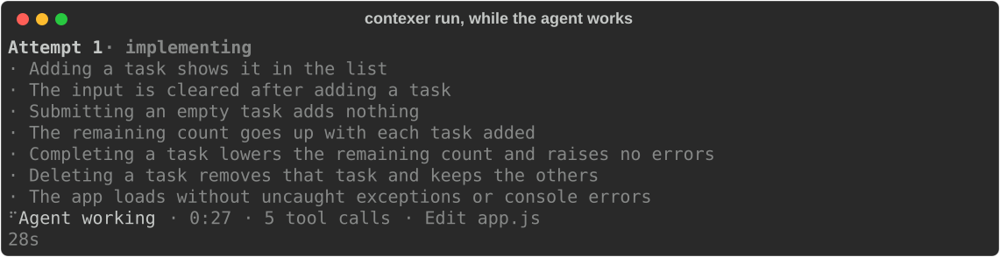
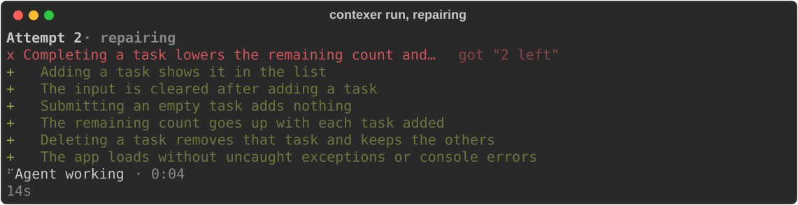
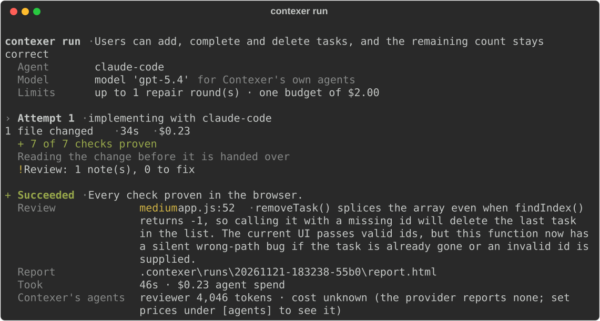
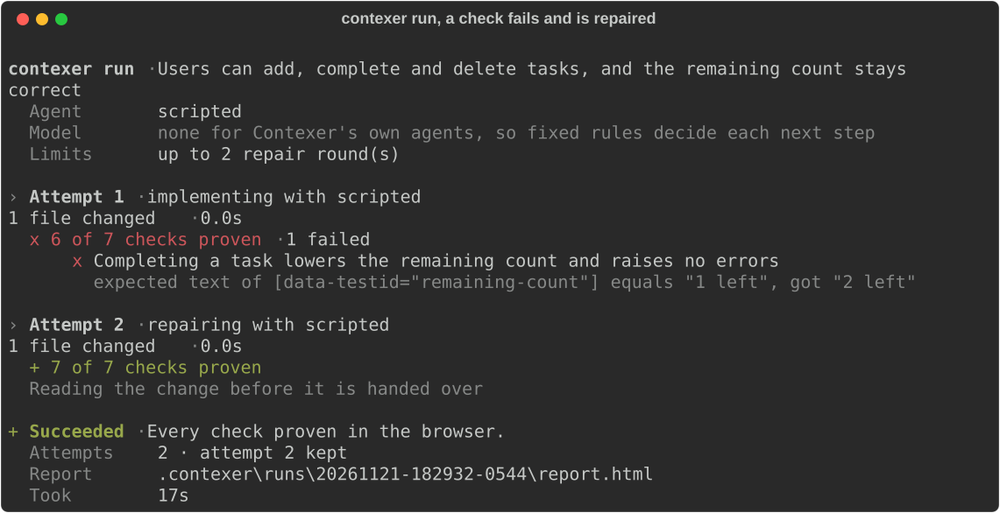

# Using Contexer

The longer how-to sections, moved here from the front page on 2026-11-28. For a first run, start with
[Try it yourself](try-it.md); for every command and setting, see the [developer guide](../README.md).

## Install

Python 3.11 or newer. The package is `contexer-agent` (`contexer` on PyPI is a
different project); the command it installs is `contexer`.

```bash
uv tool install contexer-agent   # or: pipx install contexer-agent, or: pip install contexer-agent
contexer demo          # no key needed: a todo app with a bug, caught in about ten seconds
contexer setup         # bring your own key, pick models (tested live)
contexer doctor        # checks Chromium, git, Node, model keys and agents, with the fix for each

cd contexer-demo
contexer test "Users can add tasks and complete them, and the remaining count stays correct"
```

The last command is your first result: the bugs a replay confirmed, and a
fix prompt. A new install has no browser yet; the demo offers to download
Chromium, and `contexer setup --browser` does it on its own.

The package is [on PyPI](https://pypi.org/project/contexer-agent/). For the newest
code before a release, install from GitHub:
`uv tool install "git+https://github.com/murtuza777/contexer-agent.git#subdirectory=contexer-agent"`.
`uv tool install` and `pipx` put `contexer` on your PATH in its own
environment; if `contexer` is "not recognized" after a `pip` install, see
[Windows notes](try-it.md#if-the-install-fails-on-windows).

[Try it yourself](try-it.md) walks through every step and
says what each one should show.

## While `contexer run` works

A block is redrawn in place while the coding agent works: every check that
decides the run with its state, what is happening now, and the time and
money so far. This frame is from a real run with Claude Code:



On a repair, the check that failed is at the top with what the browser saw:



What stays in the terminal, in a CI log and in a pasted issue is one line
per attempt, one for what the agent did, and one for the verdict. This is
the whole output of that run with Claude Code (one attempt, 46 seconds,
$0.23), with the note the review left:



When a check fails, it is named under the verdict with what was expected
and what was there, and the next attempt follows. (The bundled todo example;
a scripted agent stands in for the coding agent, which is why its turns
take no time.)



`--verbose` keeps every tool call of the agent in the output. `--json`
prints the run as one event per line instead, for CI and other tools.
`--plain` prints the lines without colour, redrawing or symbols, for a log or
a screen reader.

Each run also writes a self-contained `report.html`. It contains:

- the verdict, and the reasons for it, up front;
- expected vs actual for every refuted check;
- the screenshot each check was judged on;
- Playwright traces for failures;
- for `contexer run`, every attempt the agent made and the final diff.

## Bring your own key

`contexer setup` asks for a provider, your key and a model, then tests the
model with one real request before saving anything. Supported providers:
OpenRouter (including free models), Anthropic, OpenAI, Google Gemini, Groq,
DeepSeek, Mistral, Together AI, xAI, Fireworks, Cerebras, NVIDIA, a local
Ollama, or any OpenAI-compatible endpoint (`--provider custom --base-url ...`).

```bash
contexer models --providers               # the providers, and which keys you already have
contexer models --provider openrouter --free --search coder
contexer setup --provider groq --model <id> --agent opencode   # or run it with no flags and answer
contexer setup --show                     # what is saved (keys masked)
```

Settings and keys are saved per user in `~/.contexer/`, never in a project.
Exported variables, a `.env` and a project's `contexer.toml` still take
precedence. The coding agent inherits the same key: Claude Code for
Anthropic, Codex for OpenAI, and OpenCode for every other provider.

See it catch a real bug in about ten seconds, with no API key and no agent:

```bash
contexer demo          # a todo app with a bug an AI left in, proven against its contract
contexer demo --fix    # then the repair loop, driven by a clearly labelled simulated agent
```

In your app's directory:

```bash
contexer init --ci     # detect how the app starts; add the GitHub merge-gate workflow

# 1. Describe what must be true. Contexer starts your app (static, Vite or Next.js),
#    compiles the goal into checks grounded in the live UI, and tries each check on the
#    app as it is: which already pass, which fail, which can't run yet.
#    Uses the model from `contexer setup` (or any provider key in the environment).
contexer contract draft "Users can add a task and complete it, and the count updates"

# 2. Read the checklist and lock it in. Commit .contexer/contracts/.
contexer contract show <id>
contexer contract approve <id>

# 3. Prove it, with no LLM involved.
contexer verify --contract <id>

# 4. Or let a coding agent build or fix it until every check is proven.
contexer run --contract <id> --agent claude-code
```

Or do it all in one step:
`contexer run "Users can add a task and complete it, and the count updates"`.
Contexer shows the checklist and asks you to approve it before any code
changes: `y` approves, `n` does not, `e` opens the checks in your editor, and a
sentence says what to change. Without a terminal (a pipe, CI) nothing is
approved; `--yes` approves without a reading and records that.

## Hand it over as a pull request

```bash
contexer run "Users can clear completed tasks" --pr   # ends in a pull request with the evidence
contexer run --issue 42                               # the goal comes from issue #42; the PR closes it
```

With `--pr`, a run ends on a new branch `contexer/<contract>` with one commit,
pushed, and a pull request whose description lists every check with its
verdict, the regression replay, the attempts and the agent's cost. When every
check passed the pull request is ready for review; otherwise it is a draft
that says what still fails. An earlier check that was already failing before
the run does not count: it is listed in the pull request as not proven. The
commit holds only the files the run changed
plus the approved contract, never other work in your checkout. Contexer checks
the checkout before it spends anything: a git repository with a commit, on a
branch, with no uncommitted changes to tracked files. It uses `GITHUB_TOKEN` or
your `gh` login; without either it pushes the branch and prints the link that
opens the pull request.

Stopped a run with Ctrl+C? The agent is stopped at once, the project goes back
to the best attempt (or to how it was), and the unfinished work is kept:
`contexer restore <run> --stopped` brings it back, `--attempt N` any attempt,
and `--undo` reverses a restore.

## Free, with only an OpenRouter key

With `OPENROUTER_API_KEY` in your environment or `.env`, and
[OpenCode](https://opencode.ai) installed, the whole loop runs on free models:

```bash
npm i -g opencode-ai
contexer run "Members can delete a project; the project count updates" --agent opencode
```

Contexer drafts the checks with OpenRouter, OpenCode builds the change with
`nvidia/nemotron-3-ultra-550b-a55b:free`, and Contexer proves the result in
Chromium. In the first live run (2026-10-26), on the signed-in members app,
this built "delete a project" in 101 s. The result passed all 5 new checks and
the 6 that already existed, with no repair round.

Free models are rate-limited: 50 requests a day without credits, and each
agent step is one request; a small change took about 15. Before drafting,
`contexer run` reads how many are left today and says so when they are about
to run out, instead of stopping halfway (`contexer doctor` shows the count
too). Expect a few runs a day, and pick another model with
`--model openrouter/<id>` if this one disappears.

## Apps behind a login

Tell Contexer how to sign in, with a test account, in `contexer.toml`:

```toml
[auth]
url = "/login"
steps = [
  { action = "fill", target = { label = "Email" }, value = "${CONTEXER_TEST_EMAIL}" },
  { action = "fill", target = { label = "Password" }, value = "${CONTEXER_TEST_PASSWORD}" },
  { action = "click", target = { role = "button", name = "Sign in" } },
]
expect = [{ kind = "url", contains = "/dashboard" }]
```

It signs in once per run and starts every check signed in; a check marked
`"login": false` runs as a signed-out visitor. `${NAME}` values come from the
environment (CI secrets) or the project's `.env`. They are never written to
contracts, and typed secrets and password fields are masked in reports and in
what the coding agent sees.

## Gate merges in CI

```yaml
# .github/workflows/acceptance.yml
name: Acceptance gate
on: [pull_request]
permissions:
  contents: read
  statuses: write
jobs:
  gate:
    runs-on: ubuntu-latest
    env:                                       # only if contexer.toml has [auth]
      CONTEXER_TEST_EMAIL: ${{ secrets.CONTEXER_TEST_EMAIL }}
      CONTEXER_TEST_PASSWORD: ${{ secrets.CONTEXER_TEST_PASSWORD }}
    steps:
      - uses: actions/checkout@v7.0.1
      - uses: actions/setup-node@v7.0.0        # if your app needs Node
        with: { node-version: "22" }
      - uses: murtuza777/contexer-agent@main
        with:
          working-directory: .
```

The action does four things:

1. Replays every approved contract against the PR's code.
2. Posts a `contexer/acceptance` commit status that links to the evidence.
3. Writes a per-check table into the job summary.
4. Uploads `report.html` as the `contexer-report` artifact.

Make `contexer/acceptance` a required check and nothing merges until the
behaviour is proven. This repository runs the action on its own todo fixture
([`acceptance-gate.yml`](../../.github/workflows/acceptance-gate.yml)).

## Hand it issues

`contexer init --issues` adds a workflow that takes GitHub issues to proven
pull requests:

1. **Label an issue `contexer`.** Contexer drafts the checks from the issue,
   tries each one on the app as it is, and posts them as a comment. Someone
   with write access can edit the checks right in that comment.
2. **Reply `/contexer approve`.** Contexer approves the checks in your name, the
   coding agent builds it, and Contexer proves every check in Chromium,
   repairing if needed. One comment on the issue reports the run when it has
   ended.
3. **Review the pull request.** It closes the issue and carries the evidence.

Only an approval from someone with write access starts a build: the workflow
ignores other commenters, and Contexer checks the approver's access through
the API. A draft comment written by a person, rather than by the workflow, is
never treated as the checklist. The coding agent gets the model key and
nothing else: no GitHub token in its environment or in `.git/config`, since
the issue's text reaches its prompt. The job in which the agent runs has a
token that can only read. A second job, which holds the write token and runs
nothing from the repository, checks the change, pushes it and opens the pull
request. This two-job workflow has not been run on GitHub yet.

The workflow file explains its two settings: the model key as a repository
secret (`OPENROUTER_API_KEY` works with free models), and allowing GitHub
Actions to create pull requests. Locally, `contexer issue draft 42` and
`contexer issue build 42 --by <login>` do the same steps.
